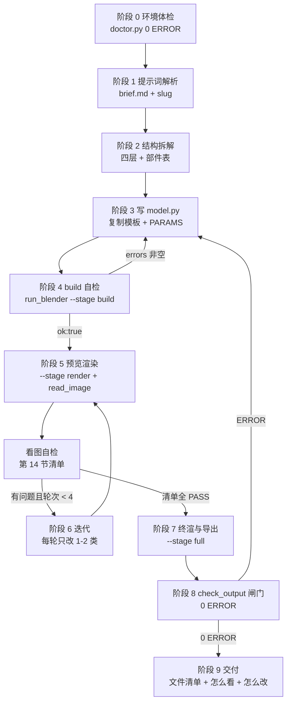

# Blender 建模技能 — 完整操作规范（AGENTS.md）

> 本文件是 blender-modeling 技能的**唯一权威完整规范**。`SKILL.md` 只是入口；动手前必须整篇读完，再按阶段 0 → 阶段 9 执行。
> 环境：Windows + Blender 4.0.2（`C:\Program Files\Blender Foundation\Blender 4.0\blender.exe`）+ 系统 Python 3.12；本文命令均在本机实测过；kit 函数以 `lib/blender_kit.py` 的公开 API（`__all__` 与 docstring）为准。

## 0. 这是什么 / 交付物定义

### 0.1 技能做什么

把用户的一句自然语言提示词，变成**真实、可交付、可复现**的 3D 模型：几何 + 材质 + 灯光相机 + 多角度渲染图 + `.blend` / `.glb` 导出。全部由本机 Blender 以 **headless bpy 脚本**完成，不依赖图形界面手工操作。

一句话边界：**模型必须由 `<输出目录>/model.py` 这个脚本生成**。手改 `.blend`、只在日志里"看起来对"、没有渲染图，都不算交付。

技能有两种模式：**模式 A（默认）从零新建**，走阶段 0 → 9；**模式 B 修改已有模型**，用 `templates/edit_model_template.py` 打开现成 `.blend` 改完再渲染导出，见第 10.5 节（其余闸门与交付要求相同）。

### 0.2 交付物（缺一即未完成）

| # | 交付物 | 位置 | 说明 |
| --- | --- | --- | --- |
| 1 | 建模脚本 | `<输出目录>/model.py` | 可复现；参数集中在顶部 `PARAMS`；只依赖 kit + 环境变量 |
| 2 | 建模简报 | `<输出目录>/brief.md` | 需求理解、量化尺寸、风格、假设、部件表、迭代记录 |
| 3 | 多角度渲染图 | `<输出目录>/renders/view-front.png` `view-right.png` `view-iso.png`（终渲再加 `final-*.png`） | 每张 > 15 KB；std > 4.0；black_ratio < 0.98 |
| 4 | 导出文件 | `<输出目录>/exports/model.blend` + `exports/model.glb` | 两者必需；`model.stl/.fbx/.obj` 按需加 |
| 5 | 场景报告 | `<输出目录>/report.json` | 物体/网格/面数/尺寸/渲染统计/导出记录；`run_blender.py --stage full` 默认还会写入 `vision` 视觉指标；`run_blender.py` 的 `logs/*.log` 是排障证据 |

### 0.3 七条铁律（违反任一条 = 任务失败）

1. **先读规范再动手**：执行阶段 0 前读完本文件；不得跳阶段。
2. **脚本是唯一真源**：所有几何/材质/灯光/相机都写在 `model.py` 里；删掉输出目录后重跑同一条命令必须得到同样的模型。
3. **必须真看图**：每轮渲染后用 `read_image` 打开 `renders/view-*.png` 逐张检查；禁止只看日志或 `BM_RESULT` 就宣称模型没问题。
4. **必须过闸门**：`scripts/doctor.py` 0 ERROR、`scripts/check_output.py` 0 ERROR（含视觉指标闸门与迭代记录校验）、第 14 节看图自检清单全 PASS，才允许向用户交付。
5. **禁止硬编码绝对路径**：`model.py` 中出现 `<技能目录>`/`<工作区>` 字面量或写死 Blender 安装路径，一律打回。用 `os.environ["BLENDER_KIT_DIR"]` / `BLENDER_OUT_DIR`。
6. **禁止把产物写进 `<技能目录>`**：`<技能目录>` 只读；产物只写到 `<工作区>/blender-models/<slug>/`。
7. **SAFE_MODE 边界**：`model.py` 不得使用 `subprocess` / `os.system` / `eval` / `exec` / 网络库 / `__import__` / `shutil.copyfile|copy|copytree`；写文件只允许 `renders/` `exports/` 等白名单目录或单段 `report.json` / `brief.md`，不得用绝对路径、盘符相对路径（如 `C:evil.txt`）、`..` 或无法静态确定的变量路径（含 `Path.open` / `write_text`，SAFE003/004/006 均为 ERROR）；交付前 `python scripts/safe_check.py` 必须 0 ERROR（仓库 `ci_check.py` 也会审 `templates/` 与 `examples/*/model.py`）。

## 1. 路径约定

### 1.1 三个路径（先想清楚再动手）

| 名称 | 定义 | 获取方式 |
| --- | --- | --- |
| `<技能目录>` | `SKILL.md` 真实所在目录（`AGENTS.md`、`scripts/`、`lib/`、`templates/`、`references/` 都在这里） | skill 工具返回的 base directory；可能是 `<工作区>\.dsh\skills\blender-modeling` 这类 junction/解析点，以 realpath 后的真实目录为准（本文示例为 `F:\DeepSeek Harness\blender-modeling`） |
| `<工作区>` | 用户当前项目根目录 = 当前 cwd | 用户指定时以用户为准 |
| `<输出目录>` | `<工作区>\blender-models\<slug>\` | 由建模目标生成，见阶段 1 |

`slug` 规则：全小写 ASCII 连字符，`<风格>-<题材>`，如 `lowpoly-coffee-mug`、`stylized-robot`、`lowpoly-cabin`；同题材改版用 `<slug>-v2`；不要用中文、空格、下划线。**同一 slug 重跑 = 覆盖该输出目录**。

### 1.2 输出目录固定结构

```
<输出目录>/
├── brief.md                 # 阶段 1/2 产出：需求理解 + 假设 + 尺寸 + 部件表 + 迭代记录
├── model.py                 # 唯一建模脚本（PARAMS 集中）
├── renders/                 # view-front.png / view-right.png / view-iso.png / final-*.png
├── exports/                 # model.blend + model.glb（必需）；model.stl/fbx/obj 按需
├── logs/                    # run_blender.py 写出的 <label>-<时间戳>.log
├── history/                 # （可选）snapshot.py 的迭代快照 v1/v2/...
├── best.json                # （可选）snapshot.py 维护的最佳版本基线
└── report.json              # kit 生成的场景 + 渲染 + vision 视觉统计 + 导出记录
```

### 1.3 路径写法铁律

- 文档/命令里的脚本路径一律写成 `scripts/xxx.py`（相对 `<技能目录>`）；不在该目录时把前缀换成 `<技能目录>\scripts\xxx.py`。给路径加引号（本机工作区路径含空格：`F:\DeepSeek Harness`）。
- `model.py` 内只用环境变量推导路径，标准写法（与 `lib/blender_kit.py` 的环境变量约定一致）：

```python
import os
import sys

SKILL_DIR = os.environ.get("BLENDER_SKILL_DIR", "")
KIT_DIR = os.environ.get("BLENDER_KIT_DIR", os.path.join(SKILL_DIR, "lib"))
if KIT_DIR and KIT_DIR not in sys.path:
    sys.path.insert(0, KIT_DIR)

OUT_DIR = os.environ.get("BLENDER_OUT_DIR", os.path.join(os.getcwd(), "blender-models", "mymodel"))
RENDERS_DIR = os.path.join(OUT_DIR, "renders")
EXPORTS_DIR = os.path.join(OUT_DIR, "exports")
```

## 2. 流程总览（阶段 0 → 阶段 9）



每阶段的产物与通过条件见第 3-12 节各阶段末尾的验收条件，汇总见第 17 节闸门表；不满足条件不得进入下一阶段。

> **模式 B（改已有模型）**：不是从阶段 1 开始，而是阶段 0 体检 → 直接跳到第 10.5 节，用 `templates/edit_model_template.py` 打开已有 `.blend` 改完，再走第 11 节交付闸门与第 12 节交付说明。

## 3. 阶段 0：环境体检

**目标**：确认 Blender、Python、kit、模板可用、当前工作目录可写；环境不通过不许开工。

> doctor 只验证**当前工作目录（cwd）**可写；真正的 `<输出目录>` 在阶段 1 建目录时验证。

```powershell
# 在 <技能目录> 下执行；不在该目录时把 scripts/ 换成 <技能目录>\scripts\
cd "F:\DeepSeek Harness\blender-modeling"
python scripts/doctor.py
# 首次在新机器/新会话上再跑一次端到端冒烟（64x64 CYCLES 渲染）
python scripts/doctor.py --smoke
# 视觉探针：零依赖解码 examples/*/renders，证明渲染图真的可读、尺寸对、非空白（不需要 Blender/Pillow）
python scripts/doctor.py --vision
```

**怎么读**：逐项 `[PASS]` / `[FAIL]` / `[WARN]`，再读汇总行如 `=== 结果: 6 PASS / 0 ERROR / 1 WARN ===`（汇总行之后还会打印一行「下一步」提示；有 ERROR 时末尾是逐条 `ERROR:` 明细）；存在 ERROR 时退出码 1。

**验收条件**

- 汇总行 `0 ERROR`，退出码 0；`--smoke` 模式下包含 64×64 CYCLES 端到端渲染 PASS（kit/模板缺失会在这里暴露）。
- 加 `--vision` 时，默认目标（`examples/*/renders`）与 `--vision-out`/`--vision-dir` 指定的目录全部 PASS——每张 PNG 可解码、像素尺寸与 `report.json` 声明一致、非空白（唯一色 ≥8 且亮度 std ≥2）。
- WARN 可以带过，但必须在 brief.md 的"环境"小节记录一条。

**失败处理**：Blender 找不到 → 设置 `$env:BLENDER_EXE`（或 `run_blender.py --blender <路径>`）；kit/模板缺失 → 检查 `<技能目录>\lib\blender_kit.py`、`templates\model_template.py` 是否存在；输出目录不可写 → 把 `<工作区>` 换到可写磁盘。doctor 的 ERROR 逐条修完后**重新跑**，不许带着 ERROR 开工。

## 4. 阶段 1：提示词解析与 brief.md

**目标**：把用户提示词（可能只有一句话）翻译成一份量化建模简报，落到 `<输出目录>/brief.md`。

### 4.1 提示词解析规则

1. **默认不追问**。尺寸、颜色、风格、用途缺失时按 `references/prompt-to-model.md` 的默认值表自行决定，并写进 brief 的"假设与默认决策"。
2. **只有两种情况允许问 1 个问题**（问完立即开工，不等第二个问题）：对象本身不明确（如"做个好看的"——不知道做什么物件）；需求自相矛盾（如"写实低多边形 100 万面"）。
3. 用户的每个风格词都要量化成参数：`可爱` → 圆角/短粗比例/高饱和；`科幻` → 硬表面/切角/发光条；`写实` → 真实尺寸/高分段/粗糙度差异。量化表见 `references/prompt-to-model.md`。
4. 一句话里有多个物件时，取用户最强调的一个作主体，其余进"场景层"或明确告诉用户"本轮只做主体"。

### 4.2 建目录 + 写 brief.md

```powershell
$OUT = "<工作区>\blender-models\<slug>"
New-Item -ItemType Directory -Force -Path $OUT, "$OUT\renders", "$OUT\exports", "$OUT\logs" | Out-Null
```

用 write 工具写 `$OUT\brief.md`（禁止 shell 重定向）。必填小节：`## 需求原句`、`## 一句话目标`、`## 风格与量化参数`、`## 尺寸（米）`、`## 颜色与材质`、`## 结构四层`、`## 部件表`、`## 假设与默认决策`、`## 环境`（doctor 的 WARN 记这里，0 WARN 写「0 WARN」）、`## 验收标准`、`## 迭代记录`。模板与示例见 `references/prompt-to-model.md`。

**验收条件**

- `brief.md` 存在，11 个小节齐全（`迭代记录` 可先空表）；尺寸表中每个数值都带单位 `m`，与最终 `report.json` 的 `dimensions` 三轴误差 ≤ 10%。
- 假设小节至少 1 条（默认不追问必然有假设）；slug 与输出目录名一致。

## 5. 阶段 2：结构拆解（四层 + 部件表）

**目标**：把"一个物件"拆成可建模的部件清单。**先拆再写代码**，不许边写边想。

### 5.1 四层拆解法

| 层 | 内容 | 数量建议 | 建模顺序 |
| --- | --- | --- | --- |
| 主体层 | 决定整体轮廓的大件（杯身、机箱、屋体、车身） | 1-3 个 | 最先 |
| 附件层 | 必须有的功能件（杯柄、机械臂、门、窗、车轮） | 2-6 个 | 第二 |
| 细节层 | 提升辨识度的小件（螺丝、按键、边缘倒角、装饰条） | 0-8 个 | build+render 通过后 |
| 场景层 | 地台、道具、可选的简单背景（通常只留地台） | 0-3 个 | 最后 |

**领域题材**：建筑、人物、动物、植物四类有专门的领域技巧文档（`references/architecture-modeling.md`、`references/character-modeling.md`、`references/animal-modeling.md`、`references/plant-modeling.md`）。这类提示词先读对应文档的结构拆解模板与比例尺寸表，再按 5.1 四层法填 5.2 部件表；文档里的技巧库与配方骨架可直接复用。

### 5.2 部件表（追加进 brief.md）

固定 9 列，一行一个部件：

| 编号 | 部件 | 层 | 图元/构造 | 尺寸(m) | 位置/旋转(m,°) | 材质 | 修改器 | 依赖 |
| --- | --- | --- | --- | --- | --- | --- | --- | --- |
| P01 | body | 主体 | `cylinder` | r=0.045 h=0.09 | (0,0,0.045) | 瓷白 | `add_bevel` 0.002 | — |
| P02 | handle | 附件 | `torus` 半圈 | R=0.03 r=0.006 | (0.05,0,0.05) rotY=90 | 瓷白 | `join`→P01 | P01 |

规则：每行必须能对应到 `model.py` 里一次 kit 调用（或一段 bmesh 构造），写不成图元的拆法不成立；主体先建模先渲染，细节层等阶段 4/5 通过后再加；层内编号连续，`join` 合并逻辑组时在"依赖"列注明。

**验收条件**：四个层都有结论（"无"也要写）；表格 9 列无空格；主体层每行尺寸与 brief 总尺寸自洽；部件总数 ≤ 15（低多边形默认）。

## 6. 阶段 3：写 model.py

**目标**：从模板复制出 `<输出目录>/model.py`，用 kit API 把部件表翻译成代码。

```powershell
Copy-Item "<技能目录>\templates\model_template.py" "$OUT\model.py"
```

### 6.1 脚本骨架（照抄结构，替换 build 里的内容）

```python
# -*- coding: utf-8 -*-
"""lowpoly-coffee-mug — 低多边形马克杯（由 templates/model_template.py 生成）。"""
import os
import sys

SKILL_DIR = os.environ.get("BLENDER_SKILL_DIR", "")
KIT_DIR = os.environ.get("BLENDER_KIT_DIR", os.path.join(SKILL_DIR, "lib"))
if KIT_DIR and KIT_DIR not in sys.path:
    sys.path.insert(0, KIT_DIR)

from blender_kit import (  # noqa: E402
    reset_scene, setup_scene, mat, assign, cylinder, torus,
    add_bevel, apply_modifiers, set_origin, join, render_views, export_all,
    save_report, stage, script_args,
)

OUT_DIR = os.environ["BLENDER_OUT_DIR"]
RENDERS_DIR = os.path.join(OUT_DIR, "renders")
EXPORTS_DIR = os.path.join(OUT_DIR, "exports")

PARAMS = {
    "mug": {"radius": 0.045, "height": 0.09, "wall_bevel": 0.002},
    "handle": {"major_radius": 0.030, "minor_radius": 0.006, "offset_x": 0.048},
    "colors": {"body": (0.92, 0.92, 0.90), "accent": (0.20, 0.45, 0.75)},
    "render": {"preview": (512, 16), "final": (960, 48)},
}

def build():
    reset_scene()
    setup_scene(target=(-0.02, 0, 0.045), distance=3.0, lens=50)
    # 说明：distance 只影响布光半径与地台尺寸；三视角取景由 render_views 按模型 bbox 自动完成
    white = mat("mug_white", color=PARAMS["colors"]["body"], roughness=0.35)
    p, h = PARAMS["mug"], PARAMS["handle"]
    body = cylinder("mug_body", radius=p["radius"], depth=p["height"],
                    vertices=24, location=(0, 0, p["height"] / 2), material=white)
    add_bevel(body, width=p["wall_bevel"], segments=2)
    body = apply_modifiers(body)  # join 前必须落地修改器，否则 join 只保留首对象修改器
    handle = torus("mug_handle", major_radius=h["major_radius"],
                   minor_radius=h["minor_radius"],
                   location=(h["offset_x"], 0, p["height"] * 0.55),
                   rotation=(90, 0, 0), material=white)
    mug = set_origin(join([body, handle], "mug"), "BOTTOM")
    assign(mug, white)
    return mug

def main():
    st = stage()
    build()
    w, s = PARAMS["render"]["preview"]
    if st in ("render", "full"):
        render_views(RENDERS_DIR, prefix="view", engine="CYCLES", samples=s, resolution=(w, w))
    if st == "full":
        w, s = PARAMS["render"]["final"]
        render_views(RENDERS_DIR, prefix="final", engine="CYCLES", samples=s, resolution=(w, w))
        export_all(EXPORTS_DIR, stem="model")
        save_report(OUT_DIR)

if __name__ == "__main__":
    main()
```

### 6.2 写代码的硬性要求

- **参数集中**：所有尺寸、颜色、采样数、分辨率、位置偏移放 `PARAMS`；函数体内只引用 `PARAMS`，不出现魔法数字（`0`/`1`/`/2` 等结构性常量除外）。
- **stage 分支**：`stage()` 返回 `build` / `render` / `full`。`build` 分支**不渲染、不导出**（要快，用于快速验错）；`render` 只渲染预览；`full` 终渲 + 导出 + 保存报告。注意 `export_all()` 内部已经写过一份 `report.json`，`save_report()` 再写一次是覆盖并补充 `extra` 字段——两者都调是无害的，不要误以为重复。
- **每个逻辑组 `join` 后 `set_origin(group, "BOTTOM")`**，方便摆放与检查。
- **`join` 前先 `apply_modifiers`**：`join()` 只保留第一个对象的修改器；多件合并前必须把倒角/细分等落地（`obj = apply_modifiers(obj)`），否则除首件外修改器静默丢失——0.002 级倒角在预览里几乎看不出来，很难事后发现。
- **只用 `lib/blender_kit.py` 的公开函数**：几何 `cube/cylinder/sphere/cone/torus/plane/tube/text`、变换/修改器、材质、渲染、导出/报告。kit 缺的能力用 `bpy`/`bmesh` 裸写（见第 15 节），但不要绕开 `reset_scene` / `stage()` / 输出路径约定。
- **透传参数**用 `script_args()` 读，例如 `python scripts/run_blender.py ... -- --mug-size large`，按需覆盖 `PARAMS`；中文注释、英文标识符；脚本必须 `# -*- coding: utf-8 -*-`。

**验收条件**

- 文件非空且含 `BLENDER_KIT_DIR` 或 `blender_kit` 字样（`check_output.py` 会检查）；用 grep 搜 `[A-Za-z]:\\` 命中数 = 0（绝对路径为零，注释里的示例也不留）。
- 部件表每一行的部件名都在 `model.py` 里出现；`PARAMS` 覆盖全部尺寸数值；脚本第二遍运行不报"对象已存在/材质重复"类错误。

## 7. 阶段 4：build 自检

**目标**：只验证"建模脚本能跑通、场景能建出来"，不渲染不导出，快速暴露语法/API/几何错误。

```powershell
cd "F:\DeepSeek Harness\blender-modeling"
$OUT = "<工作区>\blender-models\<slug>"
python scripts/run_blender.py --script "$OUT\model.py" --out "$OUT" --stage build --label build
```

**怎么读结果**：进程退出码 0 = 成功、1 = 失败；最后一行 `BM_RESULT {...}` 是机器可读 JSON，关键字段 `ok`、`exit_code`、`stage`、`log`、`duration_s`、`errors`、`warnings`、`renders`、`exports`；失败时 `ok:false`、`errors` 是数组（会过滤 `TBBmalloc` 噪音，并含 `Traceback (most recent call last):` / `Error:` 行），`log` 给出完整日志路径。

**验收条件**

- 退出码 0；`BM_RESULT` 中 `ok:true` 且 `errors:[]`；`renders:[]`、`exports:[]`（该阶段不产图不导出是正确的）。注意 `renders`/`exports` 是**目录快照**：在同一输出目录重跑 build 时会列出上一次遗留的文件，不等于本阶段产物，不要据此判失败。
- `duration_s` 建议 < 60s；明显超时说明脚本在做渲染/重计算，检查 stage 分支。

**失败处理**：打开 `log` 路径，从日志末尾往上找 `Traceback` 与最后一条 `Error:`/`RuntimeError`，修 `model.py` 对应行，重跑。**同类错误连续 2 次**立即转第 15 节降级路径，不要第三次硬试。

## 8. 阶段 5：预览渲染 + 看图自检

**目标**：用低分辨率快速渲染三视角，然后**必须用 `read_image` 真看每个文件**，按第 14 节清单找问题。

```powershell
python scripts/run_blender.py --script "$OUT\model.py" --out "$OUT" --stage render --label preview
```

随后逐张打开（三张都要看，缺一张不算自检）：

```
read_image <输出目录>\renders\view-front.png
read_image <输出目录>\renders\view-right.png
read_image <输出目录>\renders\view-iso.png
```

本机实测参考：CYCLES CPU 512×512 / 16 samples / denoise 约 1 秒/张，三张预览通常 3-5 秒；慢一个数量级说明分辨率/采样/物体数失控。

**验收条件**

- `BM_RESULT` `ok:true`、`renders` 至少 3 项，每个 `path` 文件真实存在且 > 15 KB；三张图**都**用 `read_image` 看过（迭代记录写"已看 view-front/right/iso"）。
- 第 14 节清单逐项有结论；有"需修"项 → 进阶段 6。

**常见首轮问题与动作**：全黑图 → 查灯光/相机/world（troubleshooting T-8）；主体偏小/偏边 → 三视角由 `render_views` 按 bbox 自动取景（自动忽略 `setup_floor` 地台），出现异常多半是**自建地台或离群道具/隐藏对象被算进取景**，改用 `setup_floor` 或移走离群件；手动相机 + `render_still` 时才用 `fit_camera(camera, objects, margin=1.2~1.5)`；部件悬空/穿插 → 先修位置；材质全灰 → 检查 `mat` 颜色是否 0-1 且已 `assign`。

## 9. 阶段 6：迭代

**目标**：以看图结论为依据，一轮修 1-2 类问题，最多 4 轮。

**迭代规则（硬性）**

1. 每轮必须先有"上一轮图片证据"才能改；禁止无证据大改。
2. **每轮只改 1-2 类问题**，按优先级：整体比例/布局 → 部件完整性 → 颜色材质 → 细节（倒角/平滑/分段）→ 灯光/构图 → 导出一致性。
3. 每次修改必须落到 `model.py` 的 `PARAMS` 或对应函数；手改 `.blend` 无效。
4. 每轮结束重跑 `--stage render` + `read_image`，并在 brief.md 迭代记录表登记。**每轮必须写清「看了哪几张图」与「关键量化值」**（主体占比/留白/亮度等看 `report.json.vision`，或跑 `python scripts/vision_metrics.py --out "$OUT" --write` 重算）：

| 轮次 | 看了哪张图（read_image 证据） | 问题（证据） | 改了什么（PARAMS/函数） | 重跑结果（量化值） |
| --- | --- | --- | --- | --- |
| 1 | renders/view-iso.png | view-iso 中杯柄悬空 3cm | `PARAMS["handle"]["offset_x"] 0.06→0.048` | 已贴合；主体 18.6%、四边留白 ≥22%、mean 177 std 23 |

   `check_output.py` 的 `check_iteration_records` 会校验：记录里显式写出的 `renders/xxx.png` 必须真实存在；若 `report.json` 含 `vision` 字段且不是 backfill 补写，还会检查每轮是否写了图名、提到的视角在 `renders/` 里是否有对应图、是否写了数字，且迭代表不能是空的（新产物至少 1 轮数据行，否则 ERROR）。每轮迭代通过闸门后可用 `python scripts/snapshot.py --out "$OUT"` 打快照（`--list` 看版本、`--rollback` 回退最佳版本；rollback 只还原 `model.py` / `renders/` / `report.json`，不还原 `exports/`，回滚后重跑 `--stage full` 重新导出）。

   **存量项目迁移（backfill）**：旧项目没有 `report.json.vision` 时只做宽松校验。想启用新量化校验，先跑 `python scripts/vision_metrics.py --out "$OUT" --write` 手工补写；补写的 vision 会带 `backfill: true` 与 `backfilled_at` 标记，此时 `check_output` 只校验迭代记录里的图片引用，不强制新 5 列表格。下一次 `--stage full` 会自动重算并去掉 backfill 标记，严格校验随即生效；不要手改 `report.json.vision` 里的数值。

5. 第 4 轮后仍不达标：停止迭代，交付当前最佳结果，并在交付说明里写清遗留问题与下一步改法。**不允许为了"更完美"无限循环。**

## 10. 阶段 7：终渲与导出

**目标**：出正式渲染图、`.blend`、`.glb`、`report.json`。

```powershell
python scripts/run_blender.py --script "$OUT\model.py" --out "$OUT" --stage full --label final --timeout 900
```

**验收条件**

- `BM_RESULT` `ok:true`、`errors:[]`；`renders` 至少包含 `view-*` 三张；`final-*.png` 建议 960×960（或按用户要求），全部 > 15 KB。
- `exports` 至少包含 `exports/model.blend` 与 `exports/model.glb`，两个文件非空；`<输出目录>/report.json` 存在且合法 JSON，`dimensions` 三轴为正、有相机与灯光。
- 打开 `final-iso.png` 再看一遍，与预览一致、无新问题。
- **交付 GLB 只含几何体**：kit 1.1.0 起 `export_glb/export_stl/export_fbx/export_obj` 默认排除 `kit_role="floor"` 的摄影棚地台与布尔 cutter（`.blend` 仍保留完整场景方便重渲）；真要带地台时显式传 `include_floor=True`。交付前确认 glb 里没有 `Floor` / `FloorMat` / 布尔 cutter / `.001` 重名：仓库 `examples/` 的 glb 由 `ci_check.py` 的交付资产检查把关；`check_output.py` 只查导出文件是否存在/魔数/体积（不解析 glb 内部对象名），自己输出目录的 glb 需用 Blender 导入确认。

## 10.5 模式 B：修改已有模型

**什么时候用**：用户说"改一下这个模型 / 把杯子把手加长 / 换个颜色"，并且手上已有现成 `.blend`（例如上次交付的 `exports/model.blend`，或 `examples/` 里的样例）。

**步骤**

1. 建输出目录（沿第 1.2 节结构），`brief.md` 里写清：源文件路径、要改什么、不改什么、验收标准（**不要**用"新建模型"的 brief 模板）。
2. 复制 `templates/edit_model_template.py` 到 `<输出目录>/model.py`，只改顶部 `EDITS` 字典（对象名 → 操作）与 `EXPORT_STEM`。支持的操作：

   | 操作 | 值 | 说明 |
   | --- | --- | --- |
   | `translate` | `(dx, dy, dz)` 米 | 按世界坐标平移 |
   | `rotate` | `(rx, ry, rz)` 度 | 按欧拉角旋转 |
   | `scale` | `(sx, sy, sz)` | 缩放 |
   | `material` | `("材质名", (r,g,b), roughness)` | 给该对象所有网格换材质（颜色是线性 Base Color） |
   | `hide` | `True` | 隐藏（不参与渲染与导出） |

3. 先跑 `--stage build`：日志会打印**场景对象名列表**与统计，确认要改的对象名（第一次改必然要先看这一行）。
   ```powershell
   python scripts/run_blender.py --script "$OUT\model.py" --out "$OUT" --stage build --label edit-build -- --blend "<源模型>\exports\model.blend"
   ```
4. 填好 `EDITS` 后跑 `--stage full`（或先 `--stage render` 看预览图），产物是 `model-edited.blend` / `model-edited.glb` / `view-*.png` / `report.json`。
5. 之后与模式 A 完全一样：第 11 节 `check_output.py` 0 ERROR、第 12 节交付说明（写明"基于哪个源文件改的、改了哪些对象"）。

**注意**：`open_blend` 打开后原地操作，`reset_scene()` 不会自动调用；不要在该模式下重新建场景，否则源模型会被清掉。源文件损坏时 `open_blend` 会返回 `{}` 并打印警告，此时应让用户重新提供 `.blend`。

## 11. 阶段 8：check_output.py 闸门（0 ERROR）

**目标**：交付前最后一道机器闸门。

```powershell
python scripts/check_output.py --out "$OUT"
# 可选：提高渲染图数量要求（默认 3）
python scripts/check_output.py --out "$OUT" --min-views 4
# 可选：跳过视觉指标（未装 Pillow / 只需查文件时）
python scripts/check_output.py --out "$OUT" --no-vision
```

**判读**：逐项 `[PASS]` / `[ERROR]` / `[WARN]`；任何 ERROR → 退出码 1，必须修到 0 ERROR 才可交付。

闸门除文件/报告检查外还包含三组结构检查：`check_vision` 用 `scripts/vision_metrics.py` 重算「主体占比/四边留白/底部留白/亮度」并**逐字段**与 `report.json.vision` 对照（不一致为 ERROR；任一声明的渲染图无法解码即 ERROR——全部无法解码为 VISION008、部分无法解码为 VISION009，都不再当作 SKIP/WARN 放行）；`check_iteration_records` 校验 brief 迭代记录引用的渲染图真实存在、每轮写清看了哪张图与量化值（旧产物无 `vision` 字段、或 vision 带 `backfill` 迁移标记时只查引用）；`check_snapshot` 校验 `history/` 与 `best.json` 结构（只 WARN）。

| ERROR 提示（关键字） | 含义 | 修法 |
| --- | --- | --- |
| 必需文件缺失（`model.py`/`brief.md`/`report.json`） | 有交付物没落盘 | 回阶段 1/3 补齐 |
| 渲染图数量不足 | `renders/` 少于 3 张 .png | 确认 `--stage render/full` 跑过、`render_views` 三视角 |
| `视觉闸门: 主体像素占比过小` / `过大` | 主体 < 画面 3% 或 > 90% | 调相机距离/构图；主体异常小先查地台/离群道具是否被算进取景 |
| `视觉闸门: 四边留白不足` | 某边留白 < 1%（贴边/裁切） | 用 `render_views` 自动取景，或 `fit_camera(camera, objects, margin=1.15~1.3)` |
| `视觉闸门: 底部留白过大` | 底部留白 > 55%（主体悬空/过小） | 让着地件最低点 ≈ 0，检查 origin 与位置 |
| `迭代记录引用的渲染图不存在` / `迭代记录第 N 轮缺少「看了哪张图」` | brief 记录与 `renders/` 不一致，或没写看图证据 | 按第 9 节 5 列表格补图名与量化值 |
| `视觉闸门: N 张渲染图全部无法解码` | `renders/` 里的 PNG 损坏/伪造（VISION008），视觉无法判定 | 删除坏图重渲；不要用脚本伪造渲染图 |
| `视觉闸门: 部分渲染图无法解码` | 只有部分 PNG 损坏/伪造（VISION009），视觉覆盖不全等同降低验收标准 | 重渲缺失视角；不要用占位/伪造图凑数 |
| `report.vision 与实测不一致` | report 里的视觉指标与当前渲染图不匹配（逐字段比对：主体/背景/留白/底部/亮度） | 重跑 `vision_metrics.py --write`（或 `--stage full`）让 report 与图片同步 |
| `report.renders 统计与渲染图不符` | Pillow 可用时从 PNG 重算 `mean/std/black_ratio`，与 `report.renders[]` 记录不一致（容差 mean/std 1.0、black_ratio 0.01） | report 陈旧或渲染图被替换：重跑 `--stage full` 重新生成 report，不要手改数字 |
| `report.renders 记录的 width/height/bytes 与实际不符` | report 与真实 PNG/文件脱节（手改或换图） | 重跑 `--stage full`；不要手改 report |
| `report.scene.dimensions 与 bbox_min/bbox_max 不一致` | 尺寸被改或 bbox 失真（容差 max(1e-3, 1%)） | 重跑 `--stage full`；dims 必须等于 bbox 跨度 |
| `report 里出现非有限数字` | report.json 含 NaN/Infinity（Python json 能解析但无意义，旧闸门会静默放行） | 删掉手改内容，重跑 `--stage full` |
| `渲染图 PNG 结构损坏（截断/伪造/CRC 失败）` | 只有合法文件头的假 PNG 也会被结构校验拦下（零依赖，不需要 Pillow） | 删除坏图重渲；`python scripts/vision_probe.py --dir "<输出目录>\renders"` 定位到具体文件 |
| `report.renders 存在重复记录` / `渲染图数量与渲染记录不一致` | 同一文件被统计两次，或 `renders/` 实际 PNG 数与记录条数不符 | 重跑 `--stage render/full`；删掉多余/占位图 |
| `迭代记录: report 含 vision，但…没有任何数据行` | 声明了新视觉指标却没有迭代记录（新产物至少 1 轮） | 按第 9 节补 1 行带图名与量化值的记录 |
| 渲染图过小或 `std <= 4.0` / `black_ratio >= 0.98` | 空图/全黑/纯色图 | 检查灯光/相机/world，按第 14 节重渲 |
| `report.renders 为空` | 脚本没保存渲染统计 | `full` 分支调用 `save_report(OUT_DIR)` |
| `report 缺少 blend/glb 记录` | 导出没执行或路径不对 | 调 `export_all(EXPORTS_DIR, stem="model")` |
| `model.py 未导入 blender_kit` | 脚本被写死/丢头部 | 恢复模板头部环境变量段 |
| 导出文件过小或缺失 | 导出失败/空场景 | 看该次 `logs/*.log` 末尾错误 |
| `report 的导出路径/渲染路径必须是相对路径` | report 被写成绝对路径（旧版 kit 行为） | 重跑 `--stage full`（kit 1.1.0+ 自动写相对路径）或手工改相对路径 |
| 渲染图尺寸过小 | `renders/` 里有 <64px 的占位图/假图 | 删掉占位图，重跑 `--stage render` |
| 渲染统计记录的文件不存在 | report 与 `renders/` 不一致 | 重跑 `--stage full`，让 report 与图片同时更新 |

WARN 可以带过，但要在交付说明里写明原因。视觉类 WARN（底部留白 45%-55%、亮度异常、对比度低）、`report.vision.ok 与实测不一致`、`report.vision 缺少视角`、`SNAP0xx 快照结构` 都属于「可以带过但要解释」；`report.vision 与实测不一致` 与 `report.renders 统计与渲染图不符` 已升级为 **ERROR**（report 生成后又重渲/替换了图），按上表重跑 `--stage full` 或 `vision_metrics.py --write` 消除。Pillow 缺失时 `report.renders` 重算降级为不检查（不误报），完整判定需要 Pillow（CI 已安装）。若 vision 带 `backfill: true`（存量补写），仅校验图片引用，不要求新 5 列表格；下次 `--stage full` 自动重算后严格校验生效。

## 12. 阶段 9：交付

**目标**：把"文件 + 怎么看 + 还能怎么改"一次说清。给用户的交付说明必须包含：

1. **一句话**：做了什么物件、风格、面数规模（`report.json` 的 `total_tris`）。
2. **文件清单表**：绝对路径 + 用途（`.blend` 可编辑、`.glb` 给引擎/网页、`renders/*.png` 预览、`report.json` 统计）。
3. **怎么看**：`.blend` 用 Blender 4.0 打开；`.glb` 可在 Blender `文件 → 导入 → glTF 2.0`，或拖进 Three.js / Unity / UE；预览图直接看 png。
4. **已知简化**：哪些细节是简化的、为什么（面数/时间/提示词未指定）。
5. **怎么改**：指出 `model.py` 的 `PARAMS` 位置，给出改完后的重跑命令（`--stage full`）；附迭代记录（跑了几轮、每轮修了什么、遗留什么）。

## 13. 建模质量基线（验收的底线）

| 项 | 要求 | 怎么验证 |
| --- | --- | --- |
| 单位 | 1 Blender unit = 1 米；所有尺寸按真实尺度 | `report.json.dimensions` 与 brief 表误差 ≤ 10% |
| 朝向 | 主体正面朝 **+Y**（kit 的 `front` 相机在 +Y 侧看向原点，`+Y` 侧的面就是 front 图看到的正面）；Z 轴向上 | `view-front.png` 能看到"正面"特征；`+X` 是物体右侧（front 图里显示在画面左侧，别用画面左右描述朝向） |
| origin | 每个逻辑组 `set_origin(group, "BOTTOM")`；场景根 origin 在 (0,0,0)；地台顶面 z=0 | `report.json.bbox_min[2] ≥ -1e-6`；着地件最低点 ≈ 0 |
| 命名 | 对象 `<slug>_<part>[_nn]`、材质语义英文名（如 `mug_white`）；禁止 `.001` 自动后缀 | `scene_report()["materials"]` / `object_count` 检查 |
| 分段数（低多边形） | 圆柱 `vertices` 8-16（大件可 24）；球 `segments 16 / rings 8`；总三角面 < 3000 为"低多边形"目标 | `report.json.total_tris` |
| 部件结构 | 同逻辑组合并（`join`）为一个对象；独立大件保持独立；对象数 3-20 | `report.json.mesh_count/object_count` |
| 可复现 | `reset_scene()` 起手；尺寸/颜色/位置全在 `PARAMS`；随机数固定种子；不依赖 UI 状态 | 同一命令连跑两次 `BM_RESULT ok:true`，且 dimensions 一致 |
| 材质 | 颜色给 0-1 RGB，直接写入 Principled BSDF 的**线性 Base Color**（不是 sRGB/十六进制直觉值：暖木、布料等中间调若按 sRGB 直觉给，出图会明显发白，需再压暗 30-50%）；粗糙度/金属度按风格；发光颜色用 `emission` 参数 | `view-iso.png` 上材质可辨、无全白过曝 |
| 文件体积 | `.blend` 非空（本机最小场景实测 408 KB 量级）、`.glb` 非空 | `check_output.py` PASS |

## 14. 看图自检量化清单（每轮渲染后逐项过）

> 工具：`read_image` 打开每张 `renders/view-*.png`；数值证据看 `report.json.renders[]`（`std`、`black_ratio`）与 `report.json.vision`（主体占比/四边留白/底部留白/亮度分位；`run_blender.py --stage full` 自动写入，也可 `python scripts/vision_metrics.py --out "$OUT" --write` 重算。手工补写的 vision 带 `backfill: true` 标记；`check_output` 会逐字段对照实测值，不一致为 ERROR）。另外 `check_output` 在 Pillow 可用时还会用 sRGB 亮度公式从 PNG 重算 `report.renders[]` 的 `mean/std/black_ratio`（与 kit 保存口径一致），记录值偏差超过容差（mean/std 1.0、black_ratio 0.01）即 ERROR，说明 report 陈旧或图被替换。

| # | 检查项 | 通过判据（量化） | 不通过动作 |
| --- | --- | --- | --- |
| 1 | 全黑/空图 | `std > 4.0` 且 `black_ratio < 0.98`（闸门口径）；更严：`std` 在 8-120、`mean` 在 20-235（`report.json.vision.views[].luminance` 已按此口径自动算并出 WARN）。渲染图无法解码时闸门直接 ERROR（全坏 VISION008、部分坏 VISION009，禁止 SKIP/WARN 放行），先重渲 | 查灯/相机/world，见 troubleshooting T-8 |
| 2 | 构图 | 模型完整在画面内；四边留白 ≥ 画面 5%；重心居中不偏角。占高数值仅作参考（`render_views` 固定 margin=1.15：扁平件 ≈ 47%-55%、高瘦件 ≈ 85%-90% 都属正常），不要为数字反复调相机。自动闸门：四边留白 ≥1%（`report.json.vision.margins`，低于即 `check_output` ERROR） | 主体异常小先查是否有自建地台/离群道具被算进取景 bbox（改用 `setup_floor`、移走离群件）；想要更大主体用手动相机 + `fit_camera(camera, objects, margin=1.0~1.2)` |
| 3 | 轮廓 | 只看剪影能认出目标物件；主体最大外廓宽高比与 brief 目标误差 ≤ 10% | 修主体尺寸/比例 |
| 4 | 比例 | 关键相对尺寸符合 brief 尺寸表（如杯柄高 ≈ 杯高 1/3-1/2）；整体高度与目标误差 ≤ 10% | 改 `PARAMS` |
| 5 | 部件完整性 | 部件表每一行都能在图中定位到；缺件数 = 0 | 补建缺失部件 |
| 6 | 颜色/材质 | 主色与 brief 色板一致（目视）；无整体过曝（`mean < 235`）、无整体欠曝；金属/粗糙度可区分 | 改 `mat` 参数、灯光能量 |
| 7 | 穿插 | 相接部件无可见穿模（露出反面的穿插层）；允许的设计性嵌合需在 brief 注明 | 调位置/布尔/尺寸 |
| 8 | 悬浮 | 着地件最低点与地面间隙 ≤ 0.005 m；设计性悬空件需有支撑逻辑。自动参考：`report.json.vision.bottom_gap`（底部留白）> 45% WARN、> 55% ERROR；间隙仍需看图确认 | 下移部件或加支撑件 |
| 9 | 黑面/法线 | 无纯黑补丁、无明暗突变断裂；暗部仍能辨认形状（本机 Cycles 双面光照，法线反不会直接变黑，黑面多因无灯/材质缺失） | 查灯光/材质/是否重叠遮挡 |
| 10 | 背景/地台 | 背景均匀无脏噪点带；地台与背景交界干净；透明背景（如启用）alpha 正常 | 调 `setup_world`/`setup_floor`/`film_transparent` |
| 11 | 锯齿/噪点 | 预览 512 允许轻微锯齿；终渲 960 边缘平滑、无肉眼噪点（denoise 开） | 提高分辨率/采样，开 denoise |
| 12 | 文字/细节 | 有文字时字形完整可读（中文必须加载字体，见 troubleshooting T-5）；细节件比例不失衡 | 修字体/细节尺寸 |

## 15. 失败处理与降级路径

### 15.1 错误定位三步

1. 看 `BM_RESULT`：`ok`、`errors`、`log`、`duration_s`。
2. 打开 `log` 文件，从末尾往上找 `Traceback (most recent call last):`、最后一条 `Error:`/`RuntimeError`，定位到 `model.py` 行号。
3. 首次出现先修一次；**同类错误连续 2 次** → 立即降级（15.2），不要重复第三次。

### 15.2 降级路径（连续 2 次同类失败时强制启用）

| 场景 | 降级方案 |
| --- | --- |
| kit 缺少某功能（如自定义曲面） | 用 `bpy`/`bmesh` 裸写（`bm = bmesh.new(); bm.from_mesh(obj.data); ...; bm.to_mesh(obj.data); bm.free()`），仍写回 `model.py` |
| 布尔失败/结果异常 | 改用简单图元叠加或 `add_bevel` 造倒角，不追求复杂挖孔；布尔 cutter 必须是实体，单面 `plane` 当 cutter 无效（实测） |
| 文字/中文字形缺失 | 加载系统字体：`bpy.data.fonts.load(os.path.join(os.environ["WINDIR"], "Fonts", "simhei.ttf"))` 后赋给文字对象再 `convert(target="MESH")`（实测 1866 顶点；不要写字面盘符，否则违反 6.2 的绝对路径验收） |
| 渲染太慢/超时 | 降分辨率（512→384）、降采样（16→8）、关 denoise、减部件数；先 `--stage build` 验证建模，再单独 `--stage render` |
| 全黑/纯色图 | 查灯光能量>0、world 强度>0、相机不在物体内部（kit 的 `render_still`/`render_views` 会自动补相机，裸 `bpy.ops.render.render` 才会报 `Cannot render, no camera`） |
| 导出失败 | 只用 `export_all(EXPORTS_DIR, stem="model")`；单独导出时用 `save_blend`/`export_glb`（OBJ 走 `export_obj`，不要用已移除的 `bpy.ops.export_scene.obj`） |
| 面数/复杂度失控 | 删细节层、降分段、用贴图/颜色代替几何细节 |
| 需求本身做不出（缺参考、对象自相矛盾） | 按"可执行、可验证"原则取最接近的解释，写进 brief 假设与交付说明 |

### 15.3 超时与限时

- 默认 `--timeout 600`；终渲用 `--timeout 900`。超时表现为 `ok:false`、`errors` 含 `TIMEOUT` 字样、退出码 1；先降负载，仍超时则拆阶段跑（`--stage build` 定位建模，正常则问题在渲染）。
- 单步操作连续失败超过 20 分钟，向 Lead 报告当前卡点、已试方案与证据（日志末 20 行 + 图片路径）。

## 16. 参考文档索引

| 文档 | 什么时候读 |
| --- | --- |
| `AGENTS.md`（本文件） | 动手前必读；流程、命令、验收标准的唯一权威 |
| `references/prompt-to-model.md` | 阶段 1-2：提示词量化、brief 模板、四层拆解、尺寸默认值、3 个完整示例 |
| `references/modeling-recipes.md` | 阶段 2-3：常见题材的部件拆解与代码骨架（先查有没有现成配方） |
| `references/architecture-modeling.md` | 阶段 2-3：建筑题材——墙体/楼板/屋顶/门窗阵列/台阶/栏杆的模块化拆解、真实尺寸表、技巧库与配方 |
| `references/character-modeling.md` | 阶段 2-3：人物题材——头身比量算、球棍/箱式/锥台路径、五官与发型参数、静态摆姿与实测记录 |
| `references/animal-modeling.md` | 阶段 2-3：动物题材——四足/鸟/鱼/昆虫体块拆解、剪影优先、翼面可见性、物种尺寸表与实测记录 |
| `references/plant-modeling.md` | 阶段 2-3：植物题材——递归分枝、树冠几何簇、叶卡片/花瓣环、季节配色与实测记录 |
| `references/bpy-cookbook.md` | 阶段 3-4：bpy 4.0 实测 API、修改器、导出、4.0 与旧版差异 |
| `references/render-and-check.md` | 阶段 5-6：相机/灯光/渲染参数推荐、构图、看图清单细节、迭代策略 |
| `references/troubleshooting.md` | 任何阶段报错时查：症状/原因/解决/验证 |
| `references/export-and-integration.md` | 阶段 7/9：导出格式怎么选、单位和坐标系、Three.js/Unity/UE/Godot 接入、3D 打印清单 |
| `templates/edit_model_template.py` | 第 10.5 节模式 B：修改已有 `.blend` 的操作模板 |
| `tests/README.md` | 改过 kit / 模板 / 脚本后：怎么跑回归测试（CI 与手动 Blender 两套） |
| `examples/` | 需要 few-shot 参考时看完整实测样例（`lowpoly-mug/`、`office-chair/`） |

## 17. 校验闸门表

| 闸门 | 命令（cwd=`<技能目录>`） | 通过条件 | 失败处理 |
| --- | --- | --- | --- |
| 环境闸门 | `python scripts/doctor.py`（首次加 `--smoke`；查图加 `--vision`） | 汇总行 0 ERROR、退出码 0；WARN 记录在案；`--vision` 时视觉探针全部 PASS | 按 FAIL 提示修 Blender/kit/模板/权限，重跑 |
| build 闸门 | `python scripts/run_blender.py --script "<输出目录>\model.py" --out "<输出目录>" --stage build --label build` | 退出码 0；`BM_RESULT.ok=true` 且 `errors=[]` | 读 `log` 修脚本；连续 2 次同类错误走 15.2 |
| 预览闸门 | 同上 `--stage render --label preview` | `ok=true`；`renders` ≥3；三张图均 `read_image` 真看且清单全 PASS | 修模型/灯光/相机，进迭代（≤4 轮） |
| 终渲闸门 | 同上 `--stage full --label final --timeout 900` | `ok=true`；`exports` 含 blend+glb；`report.json` 合法；final 图看好 | 检查导出分支/日志 |
| 交付闸门 | `python scripts/check_output.py --out "<输出目录>"` | 退出码 0；0 ERROR（WARN 要解释）；含 PNG 结构、report 尺寸/字节一致性、非有限数字、路径越界检查 | 按 ERROR 关键字表（第 11 节）逐条修 |
| 视觉闸门（check_output 内置） | `python scripts/vision_metrics.py --out "<输出目录>"`（或随交付闸门自动执行） | 0 ERROR：主体占比 3%-90%、四边留白 ≥1%、底部留白 ≤55%；全部声明的渲染图均可解码（任一张无法解码 → VISION008/009 ERROR）；`report.vision` 与实测逐字段一致；Pillow 可用时 `report.renders` 的 `mean/std/black_ratio` 从 PNG 重算一致（不一致 ERROR）；WARN 需解释 | 按 VISION001-007 调相机/构图/灯光；VISION008（全部无法解码）与 VISION009（部分无法解码）都必须重渲；未装 Pillow 时 SKIP，但 CI 要求 SKIP=0 |
| 视觉探针闸门（零依赖，可进 CI） | `python scripts/doctor.py --vision`（或 `python scripts/vision_probe.py --out "<输出目录>"` / `--dir "<输出目录>\renders"`） | 0 FAIL：每张 PNG 可解码（结构/CRC/IDAT/IEND 合法）、像素尺寸与 `report.renders` 声明一致、非空白（唯一色 ≥8 且亮度 std ≥2）；联系表存在时版式/格数/尺寸正确 | 按 `reasons` 重渲对应图；`--json` 给机器判决 `{ok,files,reasons}` |
| 变异闸门基准（改闸门代码后必跑） | `python scripts/gate_bench.py`（`--json` 给数字；`--selftest` 无需示例） | 退出码 0；34/34 变异被拦（本机实测抓取率 100%，`baseline_ok=true`；CI 同口径） | 表格里 `escape` 行即闸门回归：修对应检查逻辑，禁止改基准期望值来「变绿」 |
| SAFE_MODE 闸门 | `python scripts/safe_check.py "<输出目录>\model.py" templates\model_template.py templates\edit_model_template.py` | 0 ERROR（无 subprocess/eval/exec/网络/`__import__`/`shutil` 拷贝；无绝对路径、盘符相对、`..`、变量路径写文件，含 `Path.open`/`write_text`） | 删危险调用，改用 kit API 与白名单目录；`--selftest` 可先验证检查器本身 |
| 快照闸门（可选，多轮迭代） | `python scripts/snapshot.py --out "<输出目录>" --list` | `best.json` 的 schema/目录一致、best 版本结构合法（`validate_best` 无 WARN） | `--rollback` 回退最佳版本（只还原 model.py/renders/report.json，不还原 exports/），之后重跑 `--stage full` 重新导出 |
| 看图闸门 | `read_image` 打开 `renders/view-*.png`、`final-*.png` | 第 14 节 12 项全部"通过" | 回到阶段 6（或达 4 轮上限交付最佳） |
| 仓库自检闸门（改技能本体后） | `python scripts/ci_check.py` 与 `python -m unittest discover -s tests -v` | ci_check `0 ERROR`；unittest `OK` | 按报错修文档/样例/脚本；改了 kit 再跑 `tests/kit_regression.blender.py` |

## 18. 最后提醒

各阶段小节里的命令块按顺序复制即可，不再单独维护一页命令卡。**记住**：脚本可复现 > 图片好看 > 文字说明；任何"看起来没问题"都必须先有一张真看过的图和一次 0 ERROR 的闸门。
