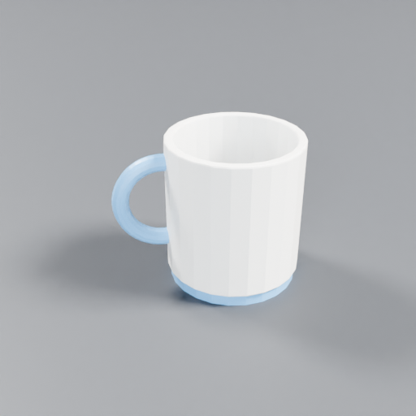
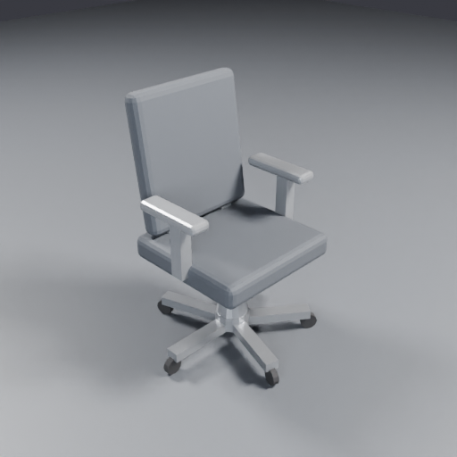
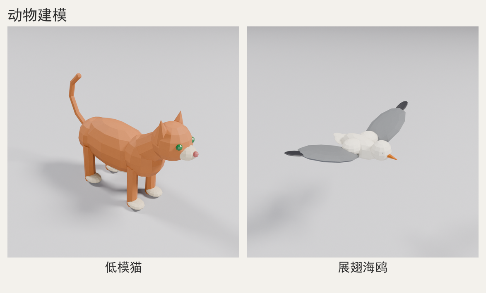
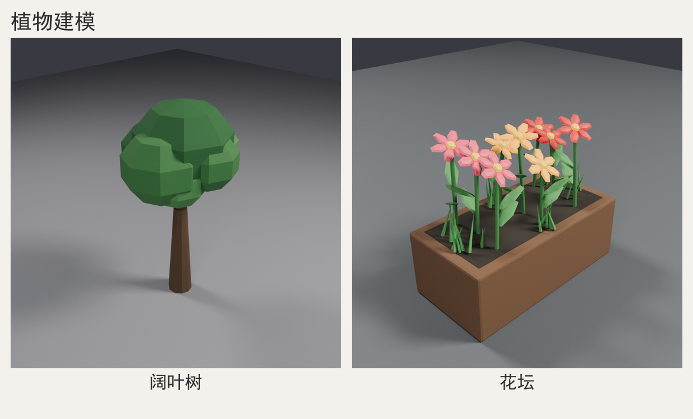

# blender-modeling — 用 Blender 按提示词建模的 Agent Skill

给 DeepSeek Harness（以及其它支持 Agent Skill 的 AI 工具）用的技能：用户输入一句建模提示词，AI 生成 bpy 脚本、用本机 Blender 无头（headless）建模、渲染多角度预览、看图自检并迭代，最后交付可用的 3D 资产。也支持**打开已有 `.blend` 修改后重导出**（模式 B）。

[](https://github.com/hwy-miaomiao/blender-modeling/actions/workflows/ci.yml)
· GitHub：[hwy-miaomiao/blender-modeling](https://github.com/hwy-miaomiao/blender-modeling)
· License：[MIT](LICENSE)
· 本机实测：Blender 4.0.2 + Windows，CYCLES CPU 预览约 1-2 秒/张

**闸门不是口号，是可跑的基准**：`scripts/gate_bench.py` 对 `examples/` 两个合格产物施加
17 种确定性变异（缺失/截断/空白/伪造 PNG、report 的尺寸/bbox/宽高/字节/NaN/路径越界/重复记录、
导出缺失与魔数损坏、联系表空白、错误尺寸）× 2 个样例 = **34 条变异，本机实测 34/34 被拦截（100%）**，
有逃逸即 `exit 1`；`scripts/vision_probe.py` / `doctor.py --vision` 用零依赖的 PNG 解码器证明
渲染图**真的可解码、尺寸符合 report 声明且非空白**（对应 Amagine3D 的 `doctor --vision` 机制），
不需要 Blender，可直接进 CI。

## 什么时候用本项目（以及什么时候不用）

| 你的需求 | 更合适的选择 |
| --- | --- |
| 要**可编辑、可复现、可交付**的 `.blend` / `.glb` / `.stl`（没有 GPU 也行），且希望每一步都能重跑 | ✅ 本项目：`model.py` 是唯一真源，参数化重建 + 无头渲染自检 |
| 只要一个「看起来对」的网格/贴图，不关心拓扑与后续编辑，且有一张参考图或一句描述 | TRELLIS / Hunyuan3D / TripoSR 这类生成模型：质量高但黑盒、要 GPU、结果难以参数化重跑 |
| 想在 Blender **GUI 里**和 AI 对话式地改模型、边看边调 | `blender-mcp` 一类 MCP 插件：交互体验好；本项目偏「无头批处理 + 交付闸门」 |
| 要把建模接进 CI / 服务端批量产出，并守住「不许执行危险代码」的边界 | ✅ 本项目 + `scripts/safe_check.py`（SAFE_MODE 静态审查） |

## 它交付什么

对一句提示词（如「做一个低多边形马克杯，暖色陶土质感」），产出一个目录：

```
<工作区>/blender-models/<slug>/
├── brief.md              # 建模简报：需求理解、假设、尺寸、风格
├── model.py              # 可复现的 bpy 建模脚本
├── renders/              # 多角度预览图（front / right / iso）
├── exports/
│   ├── model.blend       # 可在 Blender 里继续编辑
│   └── model.glb         # 可导入 Three.js / Unity / UE 等
└── report.json           # 场景统计 + 渲染统计 + 导出记录
```

## 效果预览

以下预览图都由技能自身流程生成（一句提示词 → `model.py` → 无头渲染 → `read_image` 看图迭代），
不是手工建模后截的图。

**基础样例**（对应 `examples/` 里两个完整样例，含可复现的 `model.py` 与可直接打开的 `.blend` / `.glb`）：

| 低多边形马克杯 `examples/lowpoly-mug` | 办公椅 `examples/office-chair` |
| --- | --- |
|  |  |

**领域题材**（左/右各一个实测代表题材，尺寸、面数与迭代记录见对应领域文档 §10；
拼图说明见 [`docs/previews/README.md`](docs/previews/README.md)）：

| [建筑建模](references/architecture-modeling.md)：双层联排住宅 / 石拱桥 |
| --- |
|  |

| [人物建模](references/character-modeling.md)：Q 版人物（3 头身）/ 招手人物（4.8 头身） |
| --- |
|  |

| [动物建模](references/animal-modeling.md)：低模猫 / 展翅海鸥 |
| --- |
|  |

| [植物建模](references/plant-modeling.md)：阔叶树 / 花坛 |
| --- |
|  |

## 安装（三选一）

**方式 A：项目级（推荐）**

```powershell
# 让 <工作区>\.dsh\skills\blender-modeling 指向本目录（示例中的 <工作区> 换成你的项目根目录）
cmd /c mklink /J "<工作区>\.dsh\skills\blender-modeling" "<本仓库的实际路径>"
```

**方式 B：用户级（所有项目可用）**

```powershell
# 把整个 blender-modeling 目录复制到：
C:\Users\<你>\.agents\skills\blender-modeling
```

**方式 C：从 GitHub 克隆到技能目录**

```powershell
git clone git@github.com:hwy-miaomiao/blender-modeling.git "$env:USERPROFILE\.agents\skills\blender-modeling"
# 或 HTTPS：git clone https://github.com/hwy-miaomiao/blender-modeling.git ...
```

技能目录要求包含 `SKILL.md`（带 `name` / `description` frontmatter），Harness 会自动发现。新增或修改技能后不需要重启。
本仓库的样例包含 `.blend` / `.glb` / PNG 预览（约 3 MB），克隆后即可离线查看效果。

## 前置依赖

- **Blender 4.x**（实测目标 4.0.2）。会自动在 PATH、`BLENDER_EXE` 环境变量、`C:\Program Files\Blender Foundation\` 下查找；也可在命令前设 `$env:BLENDER_EXE="...\blender.exe"`。
- **Python 3.9+**（系统 Python，跑 `scripts/*.py`；只用标准库）。
- 可选：**Pillow**（生成联系表 `contact-sheet.png`，以及计算 `report.json` 的 `vision` 视觉指标；缺失时这些能力自动 SKIP，不影响建模与交付。注意：缺失 Pillow 时视觉闸门会 SKIP 而不是判定通过；CI 会安装 Pillow 跑真实产物闸门，要求 SKIP 计数为 0。装了 Pillow 后 `check_output` 还会用 sRGB 亮度公式从 PNG 重算 `report.renders[]` 的 `mean/std/black_ratio` 并与记录对照，不一致即 ERROR）。即使没有 Pillow，`scripts/vision_probe.py`（纯标准库 PNG 解码）也能校验渲染图可解码、像素尺寸符合 `report.json` 声明且非空白。
- 无需 GPU：默认 CYCLES CPU 渲染，512px 预览每张 1-2 秒。

## 怎么用

在 Harness 里直接说「用 Blender 建一个 XXX 的模型」或输入 `/blender-modeling 低多边形马克杯`，AI 会按 `AGENTS.md` 的流程执行。

也可以手动跑。`cd` 到本技能目录只是为了让 `scripts\` 用相对路径；`<输出目录>` 必须写成 `<工作区>\blender-models\<slug>` 的**绝对路径**（含空格要加引号），不要用相对的 `blender-models\...`，否则产物会落进技能目录（违反 AGENTS 铁律 6）。

```powershell
# 约定：$OUT 是工作区里的输出目录，不要指到技能目录
$OUT = "F:\你的项目\blender-models\mug"   # 换成你的工作区

# 0. 体检（有 FAIL 先修环境）
python scripts\doctor.py --smoke

# 0.5 视觉探针（不需要 Blender）：纯标准库解码渲染图，证明「真的看过」
python scripts\doctor.py --vision

# 1. 按 AGENTS.md 第 4-7 节准备：写 $OUT\brief.md，复制模板并改写建模
New-Item -ItemType Directory -Force -Path "$OUT", "$OUT\renders", "$OUT\exports", "$OUT\logs" | Out-Null
Copy-Item templates\model_template.py "$OUT\model.py"

# 2. 执行建模脚本（build 阶段快速暴露 bpy 错误，full 阶段渲染+导出）
python scripts\run_blender.py --script "$OUT\model.py" --out "$OUT" --stage full

# 3. 交付闸门（0 ERROR 才算过；视觉指标与迭代记录也会一起校验）
python scripts\check_output.py --out "$OUT"
# 3.5 可选：单独重算视觉指标并写回 report.json（--stage full 默认已自动算）
python scripts\vision_metrics.py --out "$OUT" --write
# 3.6 可选：给通过闸门的版本打快照，并维护 best 基线（可 promote / rollback）
python scripts\snapshot.py --out "$OUT"          # 新建 history/vN
python scripts\snapshot.py --out "$OUT" --list   # 看版本表 / 当前 best

# 3.7 可选：变异闸门基准（证明闸门真的拦得住；有逃逸 exit 1）
python scripts\gate_bench.py

# 4. 可选：渲染图拼联系表
python scripts\contact_sheet.py --out "$OUT"
```

**模式 B：改已有模型**（把源 `.blend` 换成你的文件）：

```powershell
$OUT = "F:\你的项目\blender-models\mug-edit"   # 换成你的工作区
# 1. 先写 $OUT\brief.md（源文件路径、要改什么/不改什么、验收标准）——交付闸门要求它存在
# 2. 复制模板到 $OUT\model.py，编辑顶部 EDITS 字典（translate / rotate / scale / material / hide）
Copy-Item templates\edit_model_template.py "$OUT\model.py"
# 3. 渲染 + 导出（导出文件名由模板默认 EXPORT_STEM 决定，check_output 会按 report.json 记录定位）
python scripts\run_blender.py --script "$OUT\model.py" --out "$OUT" --stage full -- --blend "<源模型>\exports\model.blend"
python scripts\check_output.py --out "$OUT"
```

## 目录结构

| 路径 | 作用 |
| --- | --- |
| `SKILL.md` | 技能入口（Harness 加载它） |
| `AGENTS.md` | 完整工作规范：阶段 0-9、命令、验收条件、看图自检清单 |
| `scripts/run_blender.py` | 统一执行器：定位 Blender、注入 kit 路径、超时、日志、错误提取 |
| `scripts/doctor.py` | 环境体检（`--smoke` 跑端到端冒烟渲染；`--vision` 纯标准库验证渲染图可解码/尺寸/非空白） |
| `scripts/check_output.py` | 交付闸门（文件/魔数/渲染非全黑/report 统计/视觉指标/迭代记录/快照结构） |
| `scripts/vision_metrics.py` | 从渲染图算可量化视觉指标（主体占比/四边留白/着地间隙/亮度分布）并回写 `report.json` |
| `scripts/vision_probe.py` | 零依赖 PNG 解码探针：结构/CRC/尺寸/非空白（纯色或近纯色）校验，供 `doctor --vision`、CI 与 `check_output` 复用 |
| `scripts/gate_bench.py` | 变异闸门基准：对示例产物做确定性变异并统计拦截率，有逃逸 exit 1（不需要 Blender） |
| `scripts/snapshot.py` | 迭代版本化：`history/vN` 快照 + `best.json` 基线，支持 `--list` / `--promote` / `--rollback` |
| `scripts/safe_check.py` | SAFE_MODE 静态审查：model.py 禁止 subprocess/eval/网络/越界写文件，给出 `file:line` 级 ERROR/WARN |
| `scripts/contact_sheet.py` | 渲染图拼联系表（可选，需要 Pillow） |
| `scripts/ci_check.py` | 仓库静态检查（frontmatter / 示例产物 / 领域文档结构 / 文档引用 / 绝对路径；无需 Blender） |
| `lib/blender_kit.py` | 在 Blender 进程内 import 的辅助库（图元/材质/灯光相机/渲染/导出） |
| `templates/model_template.py` | 建模脚本骨架（模式 A） |
| `templates/edit_model_template.py` | 修改已有模型模板（模式 B：`EDITS` 字典 + `--blend`） |
| `references/` | 提示词解析、配方库、bpy 速查、建筑/人物/动物/植物领域技巧、渲染自检、报错知识库、导出与引擎接入 |
| `docs/previews/` | 建筑/人物/动物/植物建模效果预览图（实测终渲拼合，README 展示用） |
| `tests/` | 回归测试：CI 用 unittest（无需 Blender）+ 手动 Blender 冒烟/审计回归 |
| `examples/` | 两个完整实测样例（few-shot 参考，含可打开的 `.blend` / `.glb`） |
| `CHANGELOG.md` | 版本改动记录 |

## 自测与 CI

改完脚本或文档后，先跑这几条（纯标准库，不需要 Blender，几秒完成）：

```powershell
python scripts\check_output.py --selftest   # 交付闸门的纯函数自测
python scripts\vision_metrics.py --selftest # 视觉指标（不需要 Pillow）
python scripts\vision_probe.py --selftest   # 零依赖 PNG 解码探针
python scripts\gate_bench.py --selftest     # 变异闸门基准（合成产物，不需要 Blender）
python scripts\snapshot.py --selftest       # 版本快照 / best 基线
python scripts\safe_check.py --selftest     # SAFE_MODE 静态审查
python scripts\ci_check.py                  # 仓库静态检查，必须 0 ERROR
python -m unittest discover -s tests -v     # 单元/契约测试（含 ci_check、check_output、bl_common、新脚本）
# 真实产物变异基准：34 条变异必须 100% 拦截（本机实测 34/34）
python scripts\gate_bench.py
# 视觉探针：examples 两个样例判 ok，自造坏图判 fail
python scripts\doctor.py --vision
# 真实产物闸门（需要 Pillow；0 ERROR，且视觉闸门 SKIP 数必须为 0）
python scripts\check_output.py --out examples\lowpoly-mug
python scripts\check_output.py --out examples\office-chair
```

GitHub Actions（`.github/workflows/ci.yml`）在 Python 3.9 与 3.12 上跑同一套检查，外加 `compileall`、
LF 行尾检查、`pip install pillow`、`vision_probe` / `gate_bench` 自测、`doctor --vision` 视觉探针、
两个 `examples/` 的真实产物视觉闸门（SKIP 计数必须为 0），以及 Python 3.12 job 上 `gate_bench.py`
对真实示例产物的 34 条变异基准（必须 0 逃逸）；它**不调用 Blender**，真实建模与看图验收在本地按
`AGENTS.md` 第 17 节闸门表完成。
改过 `lib/blender_kit.py` 后，本地再跑一次 `tests/kit_regression.blender.py`（见 `tests/README.md`）。

## 常见问题

| 症状 | 处理 |
| --- | --- |
| `找不到 Blender` | 装 Blender 4.x，或设置 `BLENDER_EXE` 指向 `blender.exe` |
| 渲染全黑 / check_output 报 `std` 过低 | 检查相机是否对准物体、灯光是否启用、渲染是否落在空场景 |
| `Traceback` 连续出现 | 读 `run_blender.py` 输出里的 ERROR 行与日志尾部，按 `references/troubleshooting.md` 修 |
| Blender stderr 有 `TBBmalloc ... unknown prologue` | 正常噪音，忽略 |
| 渲染很慢 | 预览用 `--stage render` 或降分辨率/采样数；最终交付再提高质量 |
| 莫名 `TIMEOUT` / 日志出现 `Could not generate a temp file name` | `run_blender.py` 已把子进程 `TMP`/`TEMP`/`TMPDIR` 隔离到 `<out>/logs/tmp-*`（防 Blender 4.0.2 清空系统临时目录，见 T-23）；手工直接调 `blender.exe` 时需自行设置隔离目录 |
| 存量项目没有 `report.vision`，check_output 只做旧版宽松校验 | 想启用新量化校验：`python scripts\vision_metrics.py --out "$OUT" --write`；手工补写会写入 `vision.backfill=true`，check_output 对 backfill 只校验迭代记录里的图片引用，不强制新 5 列表格。下次 `--stage full` 自动重算后 backfill 标记消失、严格校验生效 |
| check_output 报 `report.vision 与实测不一致` | 渲染图被替换/重渲染后 report 过期：重跑 `python scripts\vision_metrics.py --out "$OUT" --write`（原子覆盖） |
| check_output 报 `report.renders 统计与渲染图不符` | Pillow 可用时会用 sRGB 亮度公式从 PNG 重算 `mean/std/black_ratio`，与 `report.renders[]` 记录不一致（容差 mean/std 1.0、black_ratio 0.01）。说明 report 陈旧或图被替换：重跑 `--stage full` 重新生成 report，不要手改数字；无 Pillow 时该检查自动降级跳过 |
| check_output 报 `report.renders 记录的 width/height/bytes 与实际不符` 或 `report.scene.dimensions 与 bbox 不一致` | report 被手改或与渲染图/场景脱节：重跑 `--stage full` 重新生成；`report.renders[].width/height/bytes` 必须与真实 PNG 一致，`dimensions` 必须等于 `bbox_max - bbox_min`（容差 max(1e-3, 1%)） |
| check_output 报 `渲染图 PNG 结构损坏（截断/伪造/CRC 失败）` | 渲染图被截断/伪造（只有合法文件头的假 PNG 也拦）：重渲染；`scripts/vision_probe.py --dir <renders>` 可单独定位到具体文件与原因 |
| `doctor.py --vision` 报某张图「空白/纯色」 | 渲染落在空场景或相机没对准物体（与 check_output 全黑判定互补的证据）；先看 `renders/` 里那张图，再查相机与灯光 |
| `gate_bench.py` 报「逃逸」并 exit 1 | 有变异没被任何闸门拦住 = 闸门回归；按表格里的 `escape` 行定位 `check_output` / `vision_probe` 对应检查并修，不要改基准的期望值来「变绿」 |
| `--rollback` 后导出文件与模型不一致 | rollback 只还原 `model.py` / `renders/` / `report.json`，**不还原 `exports/`**；回滚后重跑 `--stage full` 重新导出 |

## 设计原则

- **两段式**：`--stage build` 只建模，1-2 秒暴露 API 错误；通过后再渲染，避免长时间试错。
- **可复现**：交付 `model.py` + 参数，任何人可在本机重跑出同一结果。
- **可验证**：渲染统计（std / black_ratio）、量化视觉指标（主体占比/留白/着地间隙）与文件魔数由 `check_output.py` 自动把关，防止交付空场景或坏文件。
- **可证明**：`gate_bench.py` 用确定性变异证明闸门拦得住（本机 34/34，100%），`doctor --vision` / `vision_probe.py` 用零依赖 PNG 解码证明渲染图真的可读、尺寸对、非空白——不依赖「代理声称看过」。
- **可回溯**：迭代版本进 `history/vN`，`best.json` 记录通过闸门的基线；改坏了 `--rollback` 还原 `model.py` / `renders/` / `report.json`（不还原 `exports/`，回滚后需重跑 `--stage full` 重新导出）。
- **可审查**：`safe_check.py` 用 AST 静态审查 `model.py`，subprocess / eval / 网络 / `shutil` 拷贝 / 绝对路径与变量路径写文件（含 `Path.open`）在入库前就被拦下。
