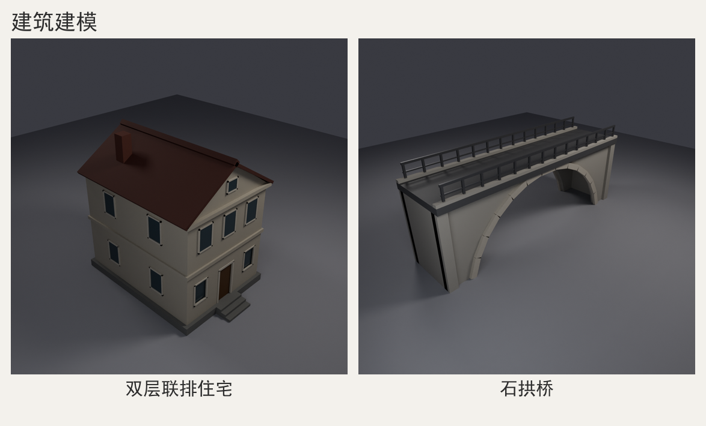

# 建筑建模配方（建筑 / 建筑群 / 桥梁 / 塔 / 庭院）

> `blender-modeling` 技能的**建筑领域补充配方集**，接在 `references/modeling-recipes.md`（通用骨架、六条硬规则、材质速查）之后。
> 读法：先读 `AGENTS.md` 全流程 → §1 定风格 → §2 拆结构 → §3 查尺寸 → §4 选技巧 → §5 抄配方 → §6-§9 配色/机位/排错/自检 → §10 是本文所有数字的实测出处。
> 代码块默认接在通用骨架 `build()` 里：`from blender_kit import *`、`import math`、`PARAMS` 已就位，路径只用 `BLENDER_KIT_DIR` / `BLENDER_OUT_DIR` 推导。

> 效果预览：

⚠ **坐标系与朝向**（与 modeling-recipes.md §0 一致，建筑再强调）：1 unit = 1 米；Z 向上；**+Y 是正面**（kit 的 front 相机在 +Y 侧）；入口、主立面一律朝 +Y；+X 是建筑右侧（在 `view-front.png` 里显示为画面左侧，别用画面左右描述朝向）。逻辑组 `join` 后 `set_origin(group, "BOTTOM")`，地面 z=0；场景 target 取 `总高 × 0.45~0.55`。

## 1. 适用范围与风格分级

适用：单体建筑（住宅/办公楼/塔）、建筑群（街景/小区/村落）、构筑物（桥梁/围墙/大门/亭）、庭院与泛环境（铺装/树/水面/道具）。

| 风格 | total_tris | 必须做到 | 允许省略 | 典型题材 |
| --- | --- | --- | --- | --- |
| 低多边形 | 800-3000 | 真实层高与开间；体块轮廓对；门窗阵列；屋顶坡度对 | 窗框分格、纹理、室内、栏杆花格、瓦面起伏 | 低模住宅、街景、桥、塔、围墙 |
| 卡通/插画 | 1500-6000 | 夸张比例（门窗放大 1.2-1.5×）、圆角、高饱和、厚屋顶 | 真实尺寸、构造细节、粗糙度差异 | 童话小屋、卡通小镇、Q 版塔 |
| 写实简化 | 3000-12000 | 真实尺寸链路；檐口/勒脚/窗套分层；墙面/屋面/玻璃/金属分材质 | 砖缝、瓦当、雕花、室内、贴图 UV | 建筑表现、古建、桥、庭院 |
| 建筑群/城市 | 3000-15000 | 体块节奏（高矮错落）、街宽与退线、重复构件阵列、远景剪影 | 每栋细节、内部、道具 | 街景、小区、村落、远景城市 |

**默认决策**（写进 brief 假设）：① 建筑默认「低多边形 + 真实尺寸」——尺寸必须真实，细节可以少；层高/门高/窗台高一失真，图一眼假。② 建筑多一个「重复」维度：窗、栏板、台阶、柱、拱石一律 `add_array` 或循环阵列，禁止手摆 20 个物体。③ 先定长宽高/层数/屋顶坡度并定死，再排门窗，最后加环境。④ 对象数：单栋 6-12，建筑群按栋 join、<30 个对象。

## 2. 结构拆解模板

四层拆解法在建筑上的映射（层定义见 AGENTS §5）：

| 层 | 建筑上的内容 | 数量 | 顺序 | 判断标准 |
| --- | --- | --- | --- | --- |
| 体块层（主体） | 台基/体块、单层或双层墙身、屋顶大形 | 1-3 | 最先 | 只留剪影也能认出「住宅/塔/桥」 |
| 结构层（附件） | 楼板/檐口/勒脚、柱列、拱券、桥台、围墙段 | 2-6 | 第二 | 每件都是结构必需，不是装饰 |
| 门窗细节层 | 门窗洞、窗框+玻璃、台阶、栏杆、烟囱、牌匾 | 0-8 | build/render 通过后 | 决定人眼尺度感与重复节奏 |
| 环境层（场景） | 地台、铺装、路、树、路灯、水面 | 0-3 | 最后 | 只留必要道具，别抢主体 |

**9 列部件表模板**（追加进 brief.md，列数与 AGENTS §5.2 一致）：

| 编号 | 部件 | 层 | 图元/构造 | 尺寸(m) | 位置/旋转(m,°) | 材质 | 修改器 | 依赖 |
| --- | --- | --- | --- | --- | --- | --- | --- | --- |
| P01 | 台基+台阶 | 主体 | `cube` + 3 级 `cube` | 6.4×8.4×0.45 | (0,0,0) | 石材 | `join` | — |
| P02 | 4 面墙（含门洞） | 主体 | `cube` + `add_boolean` | 6.0×0.24×6.1 | (0,±3.88,0.45) | 墙灰 | 布尔后 `join` | P01 |
| P03 | 楼板/檐口板 | 结构 | `cube` 外挑 0.1 | 6.2×8.2×0.20 | (0,0,3.45) | 墙灰 | `join`→P02 | P02 |
| P04 | 双坡屋顶 | 主体 | 2 斜板 + 2 三棱柱山墙 | 跨度 6.5、坡度 32° | 檐口 z=6.55 | 屋瓦 | `join` | P02 |
| P05 | 二层窗（3 扇） | 细节 | 窗模块 + `add_array` | 1.0×1.4、间距 1.8 | (0,4.02,zc2) | 玻璃+框 | `add_array`→`apply_modifiers` | P02 |

拆解口诀：**先体块（长宽高/层数/屋顶）→ 再切结构（墙厚/板厚/柱网/拱半径）→ 再排门窗（开间、阵列间距、统一标高）→ 最后环境（铺装/树/道具）**。每一行都要能写死在 `PARAMS` 里，写不成图元的拆法不成立。

## 3. 比例与尺寸参考表

单位：米。来源列 **常识**（行业常用值/规范量级）或 **实测**（本文样例会过的实际值，见 §10）。

| 项目 | 常用值 | 区间 | 来源 | 建模提示 |
| --- | --- | --- | --- | --- |
| 住宅层高（含板） | 2.8-3.0 | 2.6-3.6 | 常识 | 低模取 3.0；两层到檐口 6.2-6.6 |
| 外墙厚 | 0.24 | 0.20-0.40 | 常识/实测 | 小于 0.15 像纸片，窗洞没有进深 |
| 楼板厚 | 0.20 | 0.15-0.25 | 实测 | 外挑 0.08-0.15 当腰线 |
| 门洞 | 宽 1.1、高 2.2 | 0.9-1.8 / 2.1-2.4 | 实测 | 双开门 1.6-1.8；门是尺度锚点 |
| 窗洞（住宅） | 宽 1.0、高 1.4 | 0.9-1.8 / 1.2-2.4 | 实测 | 窗台高 0.9；窗顶与门顶同标高 |
| 台阶 | 踏面 0.30、踢面 0.15 | 0.25-0.35 / 0.14-0.18 | 实测 | 3 级总高 0.45，正好一个台基 |
| 栏杆/女儿墙 | 高 1.0-1.1 | 0.9-1.3 | 常识 | 柱距 1.1-1.5，柱截面 0.10-0.15 |
| 屋面坡度 | 32°（1:0.62） | 20°-45° | 实测/常识 | 低模 25°-38°；>50° 变哥特尖顶 |
| 檐口出挑 | 0.25 | 0.15-0.6 | 实测 | 不足像贴在墙上；过大易穿模 |
| 桥梁净跨 | 12 | 6-30 | 实测 | 拱半径 R ≈ 0.5×净跨 + 0.5；矢高 = R − 圆心埋深（cz 取绝对值） |
| 桥面宽 | 4.2 | 3.5-8.0 | 实测 | 人行桥 2.5-3.5；车行桥 ≥6（含栏杆） |
| 拱券石 | 径向厚 0.40、13 段 | 0.3-0.8 / 9-21 | 实测 | 奇数段，中间一块放大 1.1-1.2× 当拱心石 |
| 塔身收分 | 0.78-0.85/层 | 0.6-0.95 | 实测 | 8 层：底半径 3.2 → 顶 3.2×0.82⁷ ≈ 0.79 |
| 围墙 | 高 2.2、厚 0.30 | 1.8-3.0 / 0.2-0.5 | 实测 | 门柱加高 0.3-0.6、柱帽出挑 |
| 街道宽度 | 6-10 | 4-20 | 常识 | 低模取 8-12，含人行道各 1.5-2 |
| 庭院留白 | 40%-60% | 30%-70% | 实测 | 空地是负空间；树间距 ≥3 |

## 4. 技巧库

以下 11 个技巧覆盖建筑常用构造。片段默认 `m_*` 材质与 `PARAMS` 已定义。

### 4.1 模块化墙体（带洞口的墙段函数）

**适用** 任何有门洞/窗洞的墙 · **做法** 每面墙 1 个 `cube`，洞口用**实体 cube** 布尔减掉；DIFFERENCE 一次一个洞，先布尔再 `join`。

```python
def wall_with_openings(name, length, height, thick, y, openings, m):  # openings: [(中心x, 宽, 洞底z, 高), ...]
    wall = cube(name, size=(length, thick, height), location=(0, y, height / 2), material=m)
    for i, (cx, w, z0, h) in enumerate(openings):
        cut = cube("%s_cut_%02d" % (name, i), size=(w, thick + 0.6, h), location=(cx, y, z0 + h / 2))
        add_boolean(wall, cut)                    # apply=True：切完自动删 cutter
    return wall
```

**参数** 墙厚 0.20-0.40；洞口两侧墙垛 ≥0.25；洞顶到楼板底留 ≥0.3 过梁 · **坑** 布尔后 cutter 已删，别再访问（§8-2）；转角两面墙必须嵌入 0.02-0.05，否则一条黑缝；cutter 与墙共面会留 z-fighting 隐患（§8-9）。

### 4.2 布尔挖窗（窗洞 + 内嵌窗）

**适用** 需要窗洞进深与窗台的正立面；贴片窗留给低模远景 · **做法** 先按 4.1 挖洞，再在洞里放「玻璃 + 四框」；玻璃比洞口小 2×框宽，玻璃面比墙外表面内凹 0.08-0.12。

```python
F, FD, y_face = 0.07, 0.08, 4.0            # 框宽、框厚、墙外表面 y
glass = cube("win_glass", size=(w - 2 * F, 0.04, h - 2 * F), location=(x, y_face - 0.10, z0 + h / 2), material=m_glass)
frames = [cube("win_ft", size=(w, FD, F), location=(x, y_face, z0 + h - F / 2), material=m_frame),
          cube("win_fb", size=(w, FD, F), location=(x, y_face, z0 + F / 2), material=m_frame),
          cube("win_fl", size=(F, FD, h - 2 * F), location=(x - w / 2 + F / 2, y_face, z0 + h / 2), material=m_frame),
          cube("win_fr", size=(F, FD, h - 2 * F), location=(x + w / 2 - F / 2, y_face, z0 + h / 2), material=m_frame)]
win = join([glass] + frames, "win_front_01")
```

**参数** 框宽 0.06-0.10；框厚 0.06-0.10；玻璃厚 0.03-0.05；内凹 0.08-0.12 · **坑** 上下框满宽时左右框必须做 `h-2F`（对接），四框互搭会在交角出黑点（实测 §8-12）；玻璃粗糙度 0.03-0.10、金属度 0-0.2。

### 4.3 楼板叠层与层高链

**适用** 双层及以上、塔标准层、办公楼 · **做法** 所有标高从层高链推出，不手算；每层板向外挑 0.08-0.15 形成腰线。

```python
plinth, storeys, slab_t, over = 0.45, [3.0, 2.7], 0.20, 0.10
z, parts = plinth, []
for i, h in enumerate(storeys):
    parts.append(cube("wall_%02d" % i, size=(w, t, h), location=(0, 0, z + h / 2), material=m_wall))
    z += h
    parts.append(cube("slab_%02d" % i, size=(w + 2 * over, d + 2 * over, slab_t), location=(0, 0, z + slab_t / 2), material=m_wall))
    z += slab_t
z_eave = z                                    # 檐口标高交给屋顶
```

**参数** 层高 2.8-3.6（住宅）/3.4-4.2（办公）；板厚 0.15-0.25；外挑 0.08-0.15 · **坑** 板外挑别和屋顶出挑混用（会成双层腰线）；层高链只写一处，改层数只改列表。

### 4.4 门窗阵列（`add_array` 排窗）

**适用** 标准开间多窗、塔身每层窗、栏杆柱、等距拱石 · **做法** 建**一个**窗模块 → `join` → `add_array(count=n, offset=(间距,0,0))` → `apply_modifiers` 落地再 join 进墙。

```python
one = join([glass] + frames, "win_module")     # 接 §4.2
place(one, location=(-1.8, 4.02, zc))          # 第一扇居中偏左
add_array(one, count=3, offset=(1.8, 0, 0))    # 绝对位移：1.8 米/扇
one = apply_modifiers(one)                     # 阵列必须落地，否则后续 join 丢失
windows = join([one], "facade_windows_02f")
```

**参数** 窗间距 = 开间 2.7-3.6（窗宽 1.0-1.4）；count 含原件；offset 是**米** · **坑** 不传 offset 会在原位叠三份（§8-8）；没落地就 join 会丢修改器（§8-3）；每层 zc 统一由层高链算。

### 4.5 坡屋顶（双坡 + 四坡）

**适用** 住宅两坡顶/联排/教堂；四坡顶用于现代住宅、亭、塔冠 · **做法** 双坡 = 2 块薄 `cube` 绕 Y 旋转 ±坡度 + 端头三棱柱山墙；四坡 = `cone(vertices=4)` 先烘焙 45° 再非均匀缩放。

```python
pitch = math.radians(32.0)
half_roof, rise = w / 2 + 0.25, (w / 2 + 0.25) * math.tan(math.radians(32.0))
slope_len = half_roof / math.cos(pitch) + 0.20
for s in (-1, 1):                              # 双坡：两块斜板
    cube("roof_slab_%d" % (s + 1), size=(slope_len, d + 0.4, 0.16),
         location=(s * half_roof / 2, 0, z_eave + rise / 2),
         rotation=(0, s * 32.0, 0), material=m_roof)
for s in (-1, 1):                              # 山墙：三棱柱，apex 朝 +Z
    gable = cone("roof_gable_%d" % (s + 1), radius1=1.0, radius2=1.0, depth=1.0,
                 vertices=3, rotation=(90, 0, 0), material=m_wall)
    scale_obj(gable, ((w / 2) / 0.8660254, rise / 1.5, t))
    place(gable, location=(0, s * (d / 2 - t / 2), z_eave + rise / 3.0))
```

四坡顶（替换上面的双坡板）：`cone(vertices=4)` 底面是菱形（顶点在 ±X/±Y），先 `place(roof, rotation=(0,0,45))` + `apply_transform(roof, rotation=True)` 烘焙，再 `scale_obj(roof, ((w + 0.6) / 1.4142, rise, (d + 0.6) / 1.4142))`。
**参数** 坡度 25°-38°；板厚 0.12-0.20；出挑 0.2-0.35；山墙厚=墙厚 · **坑** `cone(vertices=3)` 默认 apex 在 +Y，`rotation=(90,0,0)` 后才朝 +Z（实测）；`scale_obj` 是局部轴缩放，先烘焙旋转再缩放（§8-10）；四坡顶不烘焙 45° 直接缩放 = 菱形屋顶。

### 4.6 塔身收分与重复

**适用** 办公楼、钟塔、灯塔 · **做法** 半径 `r_i = r0 × taper^i`，每层 `cylinder(vertices=8/12/16)`；每层加一圈出挑 0.10-0.15 的压顶遮接缝；顶层 `cone` 收尖或平顶加女儿墙。

```python
z, r, parts = 0.0, 3.2, []
for i in range(7):
    parts.append(cylinder("tower_body_%02d" % i, radius=r, depth=3.4, vertices=12,
                          location=(0, 0, z + 1.7), material=m_stone))
    parts.append(cylinder("tower_band_%02d" % i, radius=r + 0.12, depth=0.16, vertices=12,
                          location=(0, 0, z + 3.32), material=m_trim))
    z, r = z + 3.4, r * 0.82
crown = cone("tower_crown", radius1=r, radius2=0.0, depth=5.0, vertices=12,
             location=(0, 0, z + 2.5), material=m_roof)
tower = set_origin(join(parts + [crown], "tower"), "BOTTOM")
```

**参数** taper 0.78-0.85/层；层高 3.0-4.2；底半径 2.5-5；圆塔 12-16 段、方塔 4 段+壁柱 · **坑** 收分 <0.7 像锥子、>0.95 看不出塔形；上下段端面共面会出黑线，用腰线遮；塔越高相机 z 与 distance 越要按总高算，别切塔冠。

### 4.7 桥梁拱券（布尔挖弧 + 分段拱石）

**适用** 石拱桥、城门洞、连廊拱、券门 · **做法** 拱墙用**实体圆柱**（轴向沿 Y 贯穿，深度 > 桥宽）布尔出洞；按起拱角 `theta = acos(-cz/R)` 均分，每块拱石绕 Y 旋转 φ 摆到半径 R；奇数段 + 中间一块径向放大 1.15× 当拱心石。

```python
R, cz, n, theta = 6.5, -1.5, 13, math.acos(1.5 / 6.5)   # 起拱点落在 z=0
for s in (-1, 1):
    wall = cube("bridge_wall_%d" % (s + 1), size=(L, 0.32, 5.0), location=(0, s * 1.64, 2.5), material=m_stone)
    cut = cylinder("bridge_cut_%d" % (s + 1), radius=R, depth=W + 1.2, vertices=32, rotation=(90, 0, 0), location=(0, 0, cz))
    add_boolean(wall, cut)
dphi = 2 * theta / n; chord = 2 * R * math.sin(dphi / 2) + 0.03
for i in range(n):
    phi = -theta + (i + 0.5) * dphi
    cube("arch_ring_%02d" % i, size=(chord, 0.22, 0.40 * (1.15 if i == n // 2 else 1.0)),
         location=(R * math.sin(phi), 1.90, cz + R * math.cos(phi)),
         rotation=(0, math.degrees(phi), 0), material=m_ring)
```

**参数** R ≈ 0.5×净跨+0.5；圆心 z 取 -0.15R~-0.25R；拱石径向厚 0.3-0.8；出挑 0.15-0.25；分段 9-21 · **坑** 起拱角用 `asin(span/2/R)` 会让两端悬空（首轮实测 §10）；拱顶石超桥面会冒尖，桥面要加宽盖住；楔块旋转后底角可能低于地面 5-7cm（§8-11），整组抬 0.07 或起拱角减 0.5°。

### 4.8 台阶与栏杆重复

**适用** 入口台阶、桥面栏杆、阳台栏板 · **做法** 台阶按踏面/踢面循环叠 `cube`（进深递减、后沿贴墙）；栏杆 = 1 根柱阵列 + 2 根通长横杆。

```python
for i in range(3):                             # i=0 为最下一级，进深递减、后沿贴墙
    depth = 0.30 * (3 - i)
    cube("step_%d" % i, size=(1.8, depth, 0.15), location=(0, 4.2 + depth / 2, 0.15 * (i + 1) - 0.075), material=m_stone)
post = cube("rail_post", size=(0.12, 0.12, 1.0), location=(-7.0, 1.95, 5.9), material=m_iron)
add_array(post, count=14, offset=(1.1538, 0, 0))   # 15/13，柱距 1.1538
handrail = join([apply_modifiers(post),
                 cube("rail_top", size=(15.2, 0.10, 0.14), location=(0, 1.95, 6.4), material=m_iron),
                 cube("rail_mid", size=(15.2, 0.08, 0.08), location=(0, 1.95, 5.9), material=m_iron)], "bridge_handrail")
```

**参数** 踏面 0.25-0.35、踢面 0.14-0.18；栏杆高 1.0-1.1、柱距 1.0-1.5、柱截面 0.10-0.15；横杆 0.08-0.14 · **坑** 每级进深要对调（>n-i），否则平面成直条；柱脚嵌进桥面 0.05-0.10，悬空 1cm 就看得出；横杆比柱排短 0.3-0.5。

### 4.9 立面凹凸（檐口 / 勒脚 / 壁柱 / 凸窗）

**适用** 写实简化风格必做，否则立面像贴纸 · **做法** 在墙外表面加 3 类出挑，至少 3 个深度层次：勒脚 +0.05、腰线/檐口 +0.10-0.25、壁柱/凸窗 +0.20-0.60；凹窗见 4.2。

```python
cube("plinth", size=(w + 0.10, d + 0.10, 0.45), location=(0, 0, 0.225), material=m_stone)
cube("string_course", size=(w + 0.20, d + 0.20, 0.15), location=(0, 0, 3.45), material=m_stone)
cube("eave", size=(w + 0.40, d + 0.40, 0.20), location=(0, 0, z_eave - 0.10), material=m_stone)
for s in (-1, 1):                              # 壁柱：左右成对，别用 add_mirror 硬镜像
    cube("pilaster_%d" % s, size=(0.30, 0.30, 6.1), location=(s * (w / 2 + 0.10), d / 2, 3.5), material=m_wall)
```

**参数** 出挑 0.05-0.25（勒脚/腰线/檐口）、0.2-0.6（壁柱/凸窗）；层级 ≥3 · **坑** `add_mirror` 围绕对象**自身原点**镜像，物体已偏移时两份重叠；要么把原点放中轴，要么循环摆两份；出挑件与墙面必须凸出 ≥0.02 或嵌入 0.02，禁止完全共面。

### 4.10 庭院布局（围墙 + 门楼 + 铺装 + 留白）

**适用** 中式/日式庭院、院落住宅、园林 · **做法** 先定院墙矩形与门楼（朝 +Y），再定主轴（门-甬道-主屋），最后铺装与树；空地保留 40%-60%，树/石/灯只放 3-7 件，**负空间是设计的一部分**。

```python
W, D, hw, tw = 12.0, 14.0, 2.2, 0.30
walls = [cube("yard_wall_s", size=(W, tw, hw), location=(0, -D / 2, hw / 2), material=m_wall),
         cube("yard_wall_n", size=(W, tw, hw), location=(0, D / 2, hw / 2), material=m_wall),
         cube("yard_wall_w", size=(tw, D, hw), location=(-W / 2, 0, hw / 2), material=m_wall),
         cube("yard_wall_e", size=(tw, D, hw), location=(W / 2, 0, hw / 2), material=m_wall)]
for s in (-1, 1):                              # 门柱 + 柱帽 + 门楼横梁
    cube("gate_pillar_%d" % s, size=(0.6, 0.6, 3.0), location=(s * 2.2, -D / 2, 1.5), material=m_stone)
    cube("gate_cap_%d" % s, size=(0.9, 0.9, 0.25), location=(s * 2.2, -D / 2, 3.12), material=m_roof)
cube("gate_beam", size=(5.2, 0.35, 0.35), location=(0, -D / 2, 3.0), material=m_wood)
paving = cube("yard_paving", size=(W - 0.8, D - 0.8, 0.04), location=(0, 0, 0.02), material=m_pave)
```

**参数** 院墙高 1.8-3.0、厚 0.2-0.5；门洞宽 2.4-4.2；铺装内缩 0.3-0.5、抬高 0.01-0.02；树高 3-6 · **坑** 铺装低于地面会穿地；树干埋入地面 0.1；门楼应比院墙高 0.6-1.2，是视觉焦点。

### 4.11 街景 / 建筑群体块节奏

**适用** 城市街景、小区、村落、远景天际线 · **做法** 沿街方向循环摆 4-8 个体块，高度错落（相邻差 ≥15%）、进退线错开 1-3m、宽度不等（6-12m）；远景楼只做剪影，近景楼再加窗。

```python
heights = [9.0, 12.0, 7.5, 15.0, 10.5]
x = -18.0
for i, h in enumerate(heights):
    w, d = 6.5 + (i % 3) * 0.8, 9.0 + (i % 2) * 1.5
    cube("street_block_%02d" % i, size=(w, d, h),
         location=(x + w / 2, -1.0 + (i % 3) * 1.2, h / 2), material=m_facade)
    x += w + 1.2
```

**参数** 街宽 8-12；高 6-18；进深 8-12；栋间距 0.6-2 · **坑** 等高等距像围墙，必须有节奏；楼间留 0.6-2m，贴死会共面出黑线；建筑群只做 1-2 栋主楼细节，其余靠剪影，否则面数爆。

## 5. 代表题材配方骨架

难度 ★（照抄可出图）→ ★★★★★（需调形+多轮看图）。骨架可直接接进通用骨架的 `build()`。

### 5.1 双层住宅小楼 ★★

宽 6.0×进深 8.0；台基 0.45（3 级台阶）；一层 3.0/二层 2.7；墙厚 0.24；双坡 32°；入口朝 +Y。流程：台基 → 4 面墙（前墙布尔门洞+2 窗洞）→ 楼板/檐口 → 门/窗（贴片或 §4.2 的窗模块）→ 二层 3 窗（§4.4 阵列）→ 屋顶（§4.5）+ 烟囱。

```python
def build_house():
    P = {"w": 6.0, "d": 8.0, "t": 0.24, "h1": 3.0, "h2": 2.7, "slab": 0.20, "plinth": 0.45}
    m_wall = mat("house_wall", color=(0.50, 0.46, 0.38), roughness=0.85)
    m_stone = mat("house_stone", color=(0.20, 0.20, 0.19), roughness=0.90)
    z1 = P["plinth"] + P["h1"]                       # 二层楼板底
    z_eave = z1 + P["slab"] + P["h2"]                # 檐口标高
    half_w, half_d = P["w"] / 2, P["d"] / 2
    base = cube("house_base", size=(P["w"] + 0.4, P["d"] + 0.4, P["plinth"]), location=(0, 0, P["plinth"] / 2), material=m_stone)
    for i in range(3):                               # 3 级台阶：进深递减、后沿贴台基
        depth = 0.30 * (3 - i)
        cube("house_step_%d" % i, size=(1.8, depth, 0.15), location=(0, half_d + 0.2 + depth / 2, 0.15 * (i + 1) - 0.075), material=m_stone)
    zc_g = P["plinth"] + 0.95 + 0.70                 # 一层窗中心（窗台 0.95、窗高 1.4）
    walls = []
    for s in (-1, 1):                                # 前后墙：门洞 + 2 窗洞；侧墙不开洞（低模）
        wall = cube("house_wall_%d" % (s + 1), size=(P["w"], P["t"], z_eave - P["plinth"]),
                    location=(0, s * (half_d - P["t"] / 2), (z_eave + P["plinth"]) / 2), material=m_wall)
        for tag, (cx, cw, zc, ch) in {"door": (0.0, 1.1, P["plinth"] + 1.1, 2.2),
                                      "wl": (-1.7, 1.0, zc_g, 1.4),
                                      "wr": (1.7, 1.0, zc_g, 1.4)}.items():
            cut = cube("house_cut_%s_%d" % (tag, s), size=(cw, P["t"] + 0.6, ch), location=(cx, s * half_d, zc))
            add_boolean(wall, cut)                   # 先布尔，再 join
        walls.append(wall)
    slab = cube("house_slab", size=(P["w"] + 0.2, P["d"] + 0.2, P["slab"]), location=(0, 0, z1 + P["slab"] / 2), material=m_wall)
    eave = cube("house_eave", size=(P["w"] + 0.4, P["d"] + 0.4, P["slab"]), location=(0, 0, z_eave - P["slab"] / 2), material=m_wall)
    return set_origin(join(walls + [base, slab, eave], "house"), "BOTTOM")   # 屋顶另接 §4.5
```

> 变体：联排 = 宽 4.5 重复 3 户 + 共用山墙；日式 = 坡度 22° + 出挑 0.9 + 深木色；现代 = 平屋顶 + 女儿墙 1.1 + 大窗 2.4×1.8。

### 5.2 环形塔 / 办公塔 ★★★

底半径 3.2、层高 3.4、7 层（到檐口 23.8）+ 5m 塔冠；每层收分 0.82；正门朝 +Y。流程：逐层 `cylinder` + 腰线环 → 塔冠 → 入口雨棚 → 每层窗（窗模块 + 绕 Z 旋转 12 份的环形阵列）。

```python
def build_tower():
    m_stone = mat("tower_stone", color=(0.30, 0.30, 0.29), roughness=0.90)
    m_trim = mat("tower_trim", color=(0.42, 0.40, 0.35), roughness=0.80)
    m_roof = mat("tower_roof", color=(0.09, 0.05, 0.04), roughness=0.70)
    z, r, parts = 0.0, 3.2, []
    for i in range(7):
        parts.append(cylinder("tower_body_%02d" % i, radius=r, depth=3.4, vertices=12,
                              location=(0, 0, z + 1.7), material=m_stone))
        parts.append(cylinder("tower_band_%02d" % i, radius=r + 0.12, depth=0.16, vertices=12, location=(0, 0, z + 3.32), material=m_trim))
        z, r = z + 3.4, r * 0.82
    crown = cone("tower_crown", radius1=r, radius2=0.0, depth=5.0, vertices=12,
                 location=(0, 0, z + 2.5), material=m_roof)
    return set_origin(join(parts + [crown], "tower"), "BOTTOM")
```

> 变体：方塔 `vertices=4` + 转角壁柱；钟塔每层加 4 个拱形窗洞（布尔）；观景塔顶层外挑环形平台（`cylinder` 半径 +1.2、厚 0.3）。

### 5.3 石拱桥 ★★★

净跨 12、全长 16、桥面宽 4.2、拱墙高 5.0、R=6.5（圆心 z=-1.5，起拱点落地）、13 段拱石、栏杆高 1.0。拱墙+拱石核心见 §4.7，这里补桥面/桥台（桥面加宽盖住拱顶石，桥台端面与拱墙错开 0.02 避免共面黑缝）：

```python
def build_bridge_deck():
    L, W, wall_h, deck_t = 16.0, 4.2, 5.0, 0.40
    m_deck = mat("bridge_deck", color=(0.11, 0.11, 0.115), roughness=0.55)
    m_stone = mat("bridge_stone", color=(0.42, 0.40, 0.36), roughness=0.92)
    deck = cube("bridge_deck", size=(L, W, deck_t), location=(0, 0, wall_h + deck_t / 2), material=m_deck)
    curbs = [cube("bridge_curb_%d" % s, size=(L, 0.30, 0.18), location=(0, s * (W / 2 - 0.15), wall_h + deck_t + 0.09), material=m_stone)
             for s in (-1, 1)]
    abutments = [cube("bridge_abutment_%d" % s, size=(0.60, W - 0.20, wall_h), location=(s * (L / 2 - 0.28), 0, wall_h / 2), material=m_stone)
                 for s in (-1, 1)]
    return join([deck] + curbs + abutments, "bridge_deck_grp")
```

> 变体：多孔拱 → 拱循环 2-3 次（跨 12+8+12）；廊桥 → 桥面加柱廊 + 双坡顶；现代桥 → 拱肋用 `tube(points=[...])` 或厚板，省掉拱石。

### 5.4 围墙与庭院大门 ★★

院墙 12×14、高 2.2、厚 0.30；门楼宽 5.2、高 3.0；铺装内缩 0.4；树 3 棵；空地留 50%。院墙/门柱/铺装见 §4.10，门楼屋顶沿用 §4.5 双坡（门楼半宽 2.6 + 每边出挑 0.5 → 檐口半跨 3.1，坡度 30°）：

```python
import math

def build_gate_roof():
    m_roof = mat("gate_roof", color=(0.10, 0.11, 0.115), roughness=0.80)
    edge, pitch = 3.1, 30.0                              # 檐口半跨 = 2.6 + 出挑 0.5
    rise = edge * math.tan(math.radians(pitch))          # 1.7898
    slope = edge / math.cos(math.radians(pitch))         # 坡板长 3.5796
    for s in (-1, 1):
        cube("gate_roof_%d" % s, size=(slope, 3.6, 0.16),
             location=(s * edge / 2, -7.0, 3.0 + rise / 2),
             rotation=(0, s * pitch, 0), material=m_roof)
    # 屋脊：绕 X 轴转 45° 得到菱形水平脊盖；绕 Y 轴转会让它变斜插（实测 bbox z 2.05~6.65）
    cube("gate_ridge", size=(6.2, 0.32, 0.32), location=(0, -7.0, 3.0 + rise - 0.02),
         rotation=(45, 0, 0), material=m_roof)
```

> 变体：牌坊 → 3 间 4 柱；小区入口 → 两柱 + 保安亭；公园围墙 → 漏窗（布尔挖圆/方洞）与栏杆段交替。

### 5.5 简单街景（建筑群） ★★

5 栋、宽 6.5-8.1、高 7.5-15、进深 9-10.5；街道沿 X，人行道 1.8；进退线错落 0-2.4m。先按 §4.11 摆体块节奏，再给近景 2 栋加窗阵列，远景楼只留剪影；地面铺装 + 3-4 个路灯（柱 `cylinder` + 灯头 `sphere`）。

```python
def build_street():
    m_facade = mat("street_facade", color=(0.34, 0.33, 0.31), roughness=0.90)
    m_road = mat("street_road", color=(0.10, 0.10, 0.105), roughness=0.85)
    road = cube("street_road", size=(46, 9.0, 0.05), location=(0, 0, 0.025), material=m_road)
    walk = cube("street_walk", size=(46, 1.8, 0.15), location=(0, 5.4, 0.075), material=m_facade)
    blocks = [(-16.0, 9.0, 6.8), (-7.8, 12.0, 7.6), (0.2, 7.5, 6.6), (8.4, 15.0, 8.0), (17.0, 10.5, 7.2)]
    for i, (x, h, w) in enumerate(blocks):
        cube("street_block_%02d" % i, size=(w, 9.0 + (i % 2) * 1.5, h), location=(x, -2.0 + (i % 3) * 0.8, h / 2), material=m_facade)
    return join([road, walk], "street_ground")
```

> 变体：村落 → 双坡顶 + 白墙深木；CBD → 高矮差拉大（24 vs 9）+ 玻璃幕墙色；远景城市 → 对象 ≤12，`shade_flat` + 单色。

## 6. 材质与配色

**线性 Base Color 铁律**：`mat(color=...)` 写进 Principled BSDF 的**线性** Base Color，不是 sRGB/十六进制直觉值；按 sRGB 直觉取色出图会明显发白，须再压暗 30-50%（AGENTS §13）。下表已按出图效果校准，可直接用；从设计稿取 sRGB 值时先乘 0.5-0.65。

| 风格色板 | 墙面/体块 | 石材/铺装 | 屋面 | 玻璃/金属 | 点睛色 |
| --- | --- | --- | --- | --- | --- |
| A 暖石地中海 | 墙 (0.50,0.46,0.38) r0.85 | 石 (0.20,0.20,0.19) r0.90 | 瓦 (0.12,0.045,0.035) r0.78 | 玻璃 (0.05,0.08,0.10) r0.08；铁 (0.10,0.10,0.11) m0.6 r0.45 | 木门 (0.14,0.07,0.03) r0.60 |
| B 现代混凝土+玻璃 | 混凝土 (0.30,0.31,0.32) r0.95 | 铺地 (0.16,0.16,0.165) r0.90 | 金属屋面 (0.22,0.23,0.24) m0.7 r0.35 | 幕墙 (0.02,0.035,0.05) r0.03 m0.4；铝 (0.32,0.33,0.34) m0.85 r0.35 | 木饰面 (0.16,0.08,0.035) r0.60 |
| C 红砖联排 | 红砖 (0.30,0.10,0.06) r0.90 | 基座 (0.24,0.23,0.21) r0.90 | 屋面 (0.10,0.035,0.03) r0.75 | 白窗框 (0.55,0.53,0.48) r0.50；玻璃 (0.03,0.05,0.07) r0.08 | 铁艺 (0.07,0.07,0.075) m0.5 r0.5 |
| D 中式/日式木构 | 白灰墙 (0.55,0.53,0.47) r0.92 | 青石 (0.22,0.23,0.22) r0.90 | 青瓦 (0.09,0.10,0.11) r0.75 | 木柱 (0.10,0.05,0.025) r0.70；铜饰 (0.20,0.14,0.06) m0.8 r0.40 | 植物 (0.10,0.28,0.08) r0.85 |

约束：① 一栋建筑 ≤4 主色 + 1 点睛色，墙面与屋面一深一浅；② 玻璃永远比墙面深（0.03-0.10），否则像白塑料；③ 石/混凝土粗糙度 0.85-0.95，金属 0.3-0.5 + metallic 0.6-1.0，玻璃 0.03-0.10 + metallic 0-0.2；④ 大场景按栋给近似色（±0.03）避免「克隆楼」。

## 7. 灯光 / 相机 / 构图

- **镜头**：建筑默认 `lens=35-50`；塔/长立面用 85-135mm 压缩透视、相机拉远；桥梁/街景人眼低机位 `lens=24-35`、相机 z=1.6-2.4。实测 24mm 桥梁主体偏小，32mm + 靠近才够满。
- **distance**：取主体最大边 ×0.8-1.5。kit 三灯功率固定、灯尺寸随 distance 放大 → **distance 越大越暗**：16m 的桥用 18 偏暗、用 11 正常（实测）。宁可缩短 distance，靠 `fit_camera` 取景。
- **elevation**：立面求「正」用 8-20°；产品/鸟瞰 25-45°；高塔/桥用低位仰拍（相机 z=0.1-0.2×总高，target 取 0.5-0.6×总高）显雄伟。
- **自动取景**：`render_views` 按可见几何 bbox 自动摆相机、margin 固定 1.15（不可传参）；**自定义机位会被覆盖**，hero 图必须 `add_camera` + `render_still`（实测）。且 `render_views` 结束会恢复旧渲染设置 → 终渲 hero 前再 `setup_render` 一次，否则出 512 图（§8-13）。
- **地平线与对称**：正立面/长焦图保持相机水平（target z ≈ 相机 z），竖线才不倒；正面/right 图建筑左右留白必须相等；iso 用 ±35-45° 方位。占高参考：扁平建筑群 45-55%、单体楼 60-75%、塔/桥 70-85%（自动取景实测区间，别为数字反复调相机）。
- **构图分层**：前景（铺装/台阶/树影）- 主体（体块+立面）- 背景（天空/远景剪影）三层；负空间占 40%-60% 才透气；地台默认 20m 深灰，画面偏暗可 `film_exposure=1.1-1.3` 提亮（mean 别 >235）。

## 8. 常见错误与排查（均为本文实测原文/实测数值）

复现脚本 `.tmp\domain\arch\probe_errors.py`（逐条 try/except 打印真实异常），日志在 `.tmp\domain\arch\probes\err1\logs\`。

| # | 症状 / 报错原文 | 原因 | 修法 |
| --- | --- | --- | --- |
| 1 | `RuntimeError: Error: Cannot render, no camera`（run_blender 判 `errors:["Error: Cannot render, no camera"]`、exit 1） | 裸 `bpy.ops.render.render(write_still=True)`，场景无相机（`reset_scene` 后忘建或删了相机） | 用 `render_views` / `render_still`（自动补相机）或先 `setup_scene(...)`；别裸调渲染算子 |
| 2 | `ReferenceError: StructRNA of type Object has been removed` | `add_boolean(apply=True)` 成功后 cutter 已被删除，又访问 `cut.location` | 需要后续引用就先存数值；或 `apply=False` 保留为隐藏 cutter（kit 打 `kit_role="cutter"`，导出/取景/统计自动排除） |
| 3 | `[kit][WARN] join: 闈為涓瀵硅薄鐨勪慨鏀瑰櫒...`（Windows 日志中文 GBK 乱码，关键词 `join`/`apply_modifiers`） | `join` 只保留第一个对象的修改器，非首对象的倒角/阵列静默丢失 | join 前对每个对象 `apply_modifiers`；日志乱码不影响判断，看英文函数名 |
| 4 | 静默：屋顶几乎没坡度——32° 误写成 `0.5585`（弧度）时 z 向包围盒 0.193m，正确 1.937m | `rotation` / `place(rotation=)` 单位是**度**，kit 不转弧度 | PARAMS 角度字段加 `_deg` 后缀；只在喂 `math.sin/cos` 时 `math.radians()`，改完用 `world_bbox` 量一次 |
| 5 | 静默：`mat("x", color=红)` 后再 `mat("x", color=绿)` 不生效（实测仍 (0.9,0.1,0.1)、r0.2） | `mat()` 同名**复用**已有材质，第二次参数全忽略 | 每材质唯一命名（`<slug>_wall/_stone/_glass`）；要改色就换名或改节点 |
| 6 | `[kit][WARN] place 失败: IndexError('tuple index out of range')`，对象停在原位 | `place(obj, location=(1, 2))` 少一个分量 | location/rotation/scale 一律三元组 |
| 7 | 场景出现 `arch_wall.001` | 两个对象同名，Blender 自动加后缀 | 循环带编号（`arch_wall_%02d`）；交付前 grep `.001` |
| 8 | 静默：`add_array(post, count=3)` 不传 offset，尺寸不变 (0.1,0.1,1.0) 但 tris=36 | 副本全叠在同一位置 | offset 必填且是**米**：`offset=(1.1538,0,0)`；阵列后 `apply_modifiers` 数对象 |
| 9 | 布尔不报错但几何变双层壳：单面 plane 当 cutter 后 14 verts/24 tris（原 8/12）；共面 cutter 16/32、`non_manifold_edges=0` | cutter 非实体 / 与墙面共面，EXACT 求解退化 | cutter 必须实体 cube/cylinder，六向比开口大 0.3-0.6m；布尔后 `mesh_stats` 查 non-manifold 与面数 |
| 10 | `report.json` 尺寸失真：拱石组对象 dims 7.4×4.0×12.4、场景报高 11.077，真实顶点包围盒只有 6.539 | `world_bbox`/`scene_report` 用 `bound_box` 的 8 角点，**旋转过的 join 组会被放大** | 别用 `report.dimensions` 校验旋转件；量真实尺寸遍历顶点（`.tmp\domain\arch\inspect_bbox.py`）；join 选未旋转对象作 active 或 join 后 `apply_transform` |
| 11 | 贴地失败：`report.bbox_min[2] = -0.069`（拱石底角沉到地下）；70° 楔块探针 bbox_min=-0.418 | 楔块绕自身中心旋转后外角下沉；布尔把底面切掉 | 起拱角 `acos(-cz/R)` 保证起拱点 z=0，或整组抬 0.05-0.08；验收 bbox_min ≥ -0.005 |
| 12 | 立面异常：窗框交角黑点；桥台端面与拱墙端面之间竖向黑缝 | 四根窗框互搭（满宽/满高）在交角互插自阴影；两端面完全共面 → z-fighting | 窗框对接（左右框高 `h-2F`）；相接构件错开/嵌入 0.02-0.05，禁止完全共面 |
| 13 | 终渲自定义机位出 512×512（`final-hero.png` 265KB，正常 960 图 800KB+） | `render_views` 结束会恢复调用前的渲染设置，`render_still` 结束也会恢复原设置（1.1.1 起含 filepath/格式）——两者都不会把预览档（512/16）自动提升为终渲档 | 终渲 `render_still` 前再 `setup_render(samples=48, resolution=(960,960))` |
| 14 | `exports/` 多出 `model.blend1`（597KB 备份） | 同目录重复 `save_blend` 时 Blender 自动备份 | 交付前清空 exports 再跑 full，或在文件清单注明忽略 `.blend1` |
| 15 | 同一场景单张 512 预览从 1.9s 涨到 13.2s、960 终渲 26-82s/张 | 多任务并发抢 CPU（本机同时多个 Blender） | 别据此判断「模型变重」；看 logs 每张实际耗时，必要时错峰 |
| 16 | 日志里 `[kit][WARN]` 中文全部乱码 | Windows 控制台/日志 GBK 与 UTF-8 不一致 | 不影响逻辑；按英文关键字检索或看 `BM_RESULT.warnings` |

## 9. 验收自检清单（建筑领域补充）

先过 AGENTS §14 通用 12 项，再加下面 6 项（每项都要有图或数值证据）：

| # | 检查项 | 通过判据 | 不通过动作 |
| --- | --- | --- | --- |
| B1 | 层高/标高统一 | 同层窗顶、窗台、门顶标高一致（≤0.02m）；层高链只在 PARAMS 一处 | 改层高链，重排门窗 z |
| B2 | 门窗对齐与阵列 | 同立面窗间距相等（阵列 offset 一致）、中轴对称、窗数=开间数 | 用 `add_array` 重排；先定中轴再镜像/阵列 |
| B3 | 屋顶无穿模/无缝隙 | 屋脊与两坡板咬合 0.02-0.05；山墙底边齐檐口；坡板不漏缝、不穿出屋面 | 调 rise/z_eave/出挑，山墙三角形重算 |
| B4 | 对称与重复件 | `view-front` 左右轮廓镜像一致（设计不对称需在 brief 注明）；栏杆柱/拱石/台阶数量间距对 | 重算阵列 offset，别手挪单个件 |
| B5 | 比例可读性 | 门高/层高 ≈0.6-0.8；窗宽/开间 ≈0.3-0.5；有人尺度参照（3 级台阶 ≈膝高 0.45） | 调门窗尺寸或层高，别整体缩放建筑 |
| B6 | 贴地与负空间 | 落地件 `bbox_min ≥ -0.005`；庭院/街景留白 40%-60%，画面不顶满 | 抬/嵌构件；删 1-2 个抢戏道具 |

## 10. 实测记录

演示统一命令（cwd=`<技能目录>`，产物写 `<工作区>\.tmp\domain\arch\blender-models\<slug>\`）：`python scripts/run_blender.py --script "<输出目录>\model.py" --out "<输出目录>" --stage full --label final --timeout 900`，然后 `python scripts/check_output.py --out "<输出目录>"`。

| 题材 | slug/难度 | 阶段耗时 | objects/mesh | total_tris | dimensions（report.json） | check_output | read_image 结论 |
| --- | --- | --- | --- | --- | --- | --- | --- |
| 双层联排住宅 | `lowpoly-townhouse` ★★ | build 1.7s；preview 9.1s（3 图）；full 157.70s（6 图+导出） | 13/8 | 1176 | 6.947×9.36×9.771（bound_box 口径，含台阶/出挑/烟囱） | 27 PASS / 0 ERROR / 0 WARN | 首轮正面成立但侧立面全空 → 加 8 扇侧窗后四立面可读；遗留窗框交角黑点（§8-12） |
| 石拱桥 | `lowpoly-arch-bridge` ★★★ | build 1.6s；preview 8.0s（4 图）；full 183.76s（8 图：4 view + 4 final，含 hero） | 10/4 | 900 | 16.0×4.2×11.077（report 口径；真实顶点包围盒 16.0×4.2×6.539，见 §8-10） | 31 PASS / 0 ERROR / 0 WARN | 首轮拱石悬空+拱顶冒尖 → 按起拱角重算、桥面加宽；hero 24mm 偏小 → 32mm 重构图；遗留桥台端面黑缝（§8-12） |

迭代记录（每轮均有 `read_image` 证据）：

| 轮次 | 题材 | 问题（图片证据） | 改了什么 | 重跑结果 |
| --- | --- | --- | --- | --- |
| 1 | townhouse | `view-right` 侧立面空白，四立面只有正面可读 | 新增 `_window_x()` + 4 面侧墙各 2 扇×2 层（贴立面 8 扇） | 侧立面出现两排窗，与正面节奏一致 |
| 1 | bridge | `view-front` 拱石两端悬空在 z≈1.1、拱顶冒出桥面、桥台端头突出、整体偏暗 | 起拱角改 `acos(-cz/R)`、拱石居中半径 R、桥面加宽到 4.2、桥台缩到 4.0、stone 提亮、distance 18→11 | 拱石落地成环、拱顶不冒尖，亮度正常 |
| 2 | bridge | `view-hero` 主体偏小、24mm 太广 | hero (11.5,13,2.6)/target z=3.4/lens 32；终渲前补 `setup_render(960,48)` | `final-hero.png` 960×960（867KB），桥占画面约 80% |
| 3 | townhouse | full 后 `report.dimensions` 与真实包围盒差 0.84m | 用 `.tmp\domain\arch\inspect_bbox.py` 逐顶点复核，确认是 bound_box 角点口径（§8-10），非建模错误 | 不改模型，在本文记录口径差异 |

**数据来源**：objects/tris/dimensions 取自各输出目录 `report.json`（kit `scene_report`）；耗时取自 `logs/final-*.log` 的 `[kit] 渲染完成` 行与 `BM_RESULT.duration_s`；图片结论来自 `read_image` 逐张查看；错误原文来自 `probe_errors.py` 日志与 `probe_cone.py` 探针（三棱柱方向、plane cutter、array 求值）。
