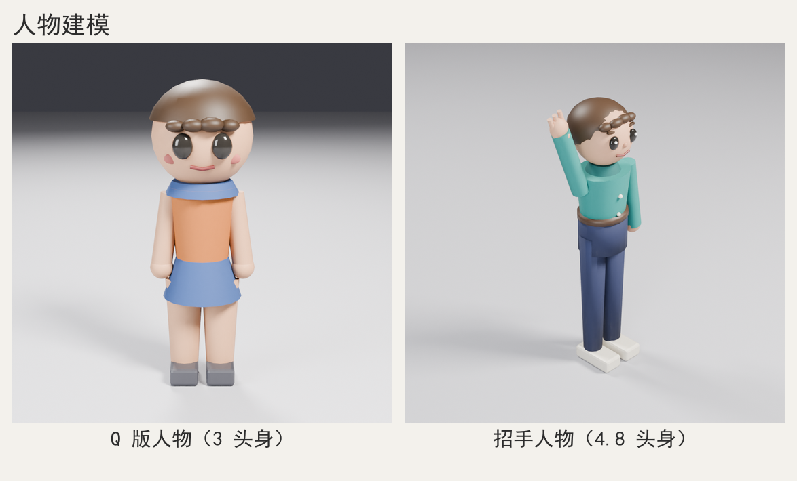

# 人物 / 角色建模技巧（character-modeling）

> 用本技能 kit 把人物做成**静态风格化模型**（Q 版 / 卡通比例 / 写实简化），交付几何 + 材质 + 预览图 + `.blend`/`.glb`。
> 通用骨架、六条硬规则、输出目录与闸门一律照 `AGENTS.md` 与 `references/modeling-recipes.md`；本文只补**人物特有**的知识。

> 效果预览：

## 坐标系与人像约定

- 1 Blender unit = 1 m，Z 向上；人物**正面朝 +Y**（kit 的 front 相机在 +Y 侧看向原点）。
- +X 是人物自身右侧，所以 `view-front.png` 里 +X 显示在画面**左**侧；描述朝向用 +Y/-Y，不用"画面左右"。
- 站姿人物脚底 = 地台顶面 = z 0；每个逻辑组 `set_origin(group, "BOTTOM")`。
- 命名 `<slug>_<part>`（`chibi_head`、`hero_arm_up`），材质语义英文名（`chibi_skin`、`hero_shirt`）。
- **kit 没有骨骼/绑定/权重/UV 能力**（`__all__` 无 armature 相关函数）：动作只能靠静态几何摆姿（§4.10），需要骨骼请另行说明并用裸 bpy。

## 1. 适用范围与风格分级

| 分级 | 头身比 H/头高 | 总高 H(m) | 头高(m) | tris 目标 | 部件数 | 取舍重点 |
| --- | --- | --- | --- | --- | --- | --- |
| Q 版 | 2.5-3.5 | 0.6-1.2 | H/比 | 1500-3000 | 10-14 | 头/眼/发型必须夸张；可省手指、鼻、耳、褶皱 |
| 卡通 | 4-5.5 | 1.2-1.8 | 0.28-0.36 | 2500-6000 | 14-20 | 五官齐全；手指 3 根可读即可；服装分层 |
| 写实简化 | 6-8 | 1.6-1.9 | 0.21-0.25 | 4000-9000 | 18-25 | 头身近真人；五官只做体块暗示；褶皱靠倒角 |

判定 4 步：① 提示词取关键词（`Q版/可爱/盲盒`→3 头身、`卡通/少年/游戏 NPC`→4-5、`写实`→7）；② 定 H（Q 0.9、卡通 1.6-1.7、写实 1.75，见 `prompt-to-model.md` §7）；③ 头高 = H/头身比，余下按 §3 表切分；④ 决定取舍——**先五官与剪影，后手指与褶皱**。

建模策略：球棍式（`sphere`+`cylinder`+`cone`，关节球过渡，如 `demo-chibi` 2790 tris）适合 Q 版/卡通快速出形；箱式体块（`cube`+`add_bevel`+锥台，见 `modeling-recipes.md` §2.15）适合硬朗角色/机器人；混合（锥台躯干+球头+圆柱四肢+布尔细节，如 `demo-wave` 4052 tris）适合多数风格化人物。

## 2. 结构拆解模板

人物把通用四层换成下面四层，顺序即建模顺序：

| 层 | 内容 | 数量 | 建模顺序 | 示例 |
| --- | --- | --- | --- | --- |
| 躯干体块层 | 躯干、胯/裙/短裤、脖、领口 | 2-4 | 最先 | `cone` 躯干、`cylinder` 短裤、`cone` 裙 |
| 四肢与头层 | 头、臂（单段或两段）、腿、手、脚 | 6-10 | 第二 | `sphere` 头、`cylinder` 臂、`cube`+bevel 鞋 |
| 服装与发型细节层 | 发壳、刘海、袖口、腰带、眼/眉/嘴/鼻/腮红 | 4-10 | 第三 | 布尔碗盖发、`tube` 微笑弧 |
| 道具与环境层 | 地台、手持道具、第二个人物 | 0-3 | 最后 | `setup_floor`、杯子/球、双人场景 |

9 列部件表模板（一行一个可建模部件，示例来自 `demo-chibi`）：

| 编号 | 部件 | 层 | 图元/构造 | 尺寸(m) | 位置/旋转(m,°) | 材质 | 修改器 | 依赖 |
| --- | --- | --- | --- | --- | --- | --- | --- | --- |
| P01 | head | 四肢与头 | `sphere` r=0.150 | 0.30×0.29×0.30 | (0,0,0.750) | 皮肤 | scale+`apply_transform` | — |
| P02 | hair | 细节 | `sphere` r=0.162 + 布尔 cube | 0.33×0.33×0.16 | (0,-0.012,0.752) | 头发 | `add_boolean` DIFFERENCE | P01 |
| P03 | bangs×4 | 细节 | `sphere` 压扁 | r 0.029-0.036 | z≈0.79，y 球面方程解 | 头发 | — | P02 |
| P04 | eye×2 | 细节 | `sphere` scale(1,0.6,1.25) | r=0.030 | (±0.055,0.136,0.735) | 眼 | — | P01 |
| P05 | mouth | 细节 | `tube` 3 点弧 | r=0.0055 | z=0.668 | 嘴 | — | P01 |
| P06 | torso | 躯干 | `cone` r1=0.072 r2=0.100 | h=0.300 | (0,0,0.450) | 上衣 | — | — |
| P07 | arm×2 | 四肢 | `cylinder` r=0.032 | h=0.220 | (±0.108,0,0.470) rotY=∓8 | 皮肤 | — | P06 |
| P08 | hand×2 | 四肢 | `sphere` r=0.036 | — | (±0.123,0,0.350) | 皮肤 | — | P07 |
| P09 | skirt | 躯干 | `cone` r1=0.120 r2=0.078 | h=0.130 | (0,0,0.325) | 裙 | — | P06 |
| P10 | leg×2 | 四肢 | `cone` r1=0.042 r2=0.058 | h=0.280 | (±0.055,0,0.175) | 皮肤 | — | P09 |
| P11 | foot×2 | 四肢 | `cube` 0.085×0.145×0.055 | — | (±0.055,0.022,0.0275) | 鞋 | `add_bevel` 2 段 | P10 |

拆解纪律：① 每行对应一次 kit 调用（或一段 bmesh/布尔），写不成图元的拆法不成立；② 先躯干+头渲一遍确认轮廓，再加四肢与细节，禁止一次写 20 个部件再渲；③ 对称件只写一侧（`for s in (-1,1)` 或 `add_mirror`，§4.4）；④ 逻辑组 join 后 `set_origin("BOTTOM")`，Q 版 2-4 个对象、卡通 3-6 个；⑤ 部件总数 Q 版 ≤14、卡通 ≤20，每行尺寸须能由总高推出（误差 ≤10%）；⑥ 服装件 = 对应身体部位 ×(1.04-1.10)，z 向重叠 0.01-0.02 m 防露缝。

## 3. 比例与尺寸参考表

单位米。`实测` 两列来自本文两个 demo 的 `PARAMS`/`report.json`；`常识` 按人体系数（肩高 0.82H、胯高 0.49H、肘高 0.63H、膝高 0.28H）折算。

| 部位 | 3 头身 Q 版 | 4.5 头身卡通 | 7 头身写实 | 来源 |
| --- | --- | --- | --- | --- |
| 总身高 H | 0.90 | 1.62 | 1.75 | 实测 / 常识 |
| 头高（含发） | 0.30 | 0.34 | 0.23 | 实测 / 常识 |
| 头身比 | 3.00 | 4.78 | 7.6 | 实测 |
| 头宽 / 头深 | 0.300 / 0.288 | 0.340 / 0.330 | 0.155 / 0.200 | 实测 |
| 颈长 | 0.070 | 0.100 | 0.070 | 实测 / 常识 |
| 肩宽（外缘） | 0.240 | 0.470 | 0.450 | 实测（2×(shoulder_x+arm_r)） |
| 胸宽 | 0.200 | 0.330 | 0.300 | 实测（2×chest_r） |
| 上臂长 / 前臂长 | 0.110 / 0.100 | 0.190 / 0.170 | 0.190 / 0.160 | 常识 0.172H / 0.146H |
| 大腿长 / 小腿长 | 0.120 / 0.120 | 0.240 / 0.230 | 0.260 / 0.250 | 常识 0.245H / 0.246H |
| 手掌长 | 0.072 | 0.110 | 0.110 | 实测（Q 版球径）/ 常识 0.11H |
| 脚长 | 0.145 | 0.260 | 0.260 | 实测（shoe y）/ 常识 0.152H |
| 胯高 | 0.360 | 0.860 | 0.860 | 实测 / 常识 0.49H |
| 眼距（眼心距） | 0.110 | 0.136 | 0.065 | 实测（2×eye_x） |
| 眼半径 | 0.030 | 0.034 | 0.020 | 实测（Q 版≈头高 0.10） |

量算顺序：Q 版头/躯干/腿各 1/3；卡通与写实按常识系数插值。差别主要在**腿占比与头放大倍数**——7 头身腿占 0.49H，3 头身腿只占 0.33H，头从 0.14H 放大到 0.33H。

```python
def q_ratio_heights(total_h):
    """3 头身：头/躯干/腿各 1/3；先算再建模，别边写边估。"""
    third = total_h / 3.0
    return {"head_h": third, "torso_h": third, "leg_h": third}
```

## 4. 技巧库

### 4.1 头身比量算 ★
- **适用/做法**：任何人物第一件事，决定其余全部尺寸；定分级 → 定 H → 头高 = H/头身比 → 按 §3 表切躯干/腿/臂，全部写进 `PARAMS["proportions"]`。
```python
PROPS = {"total_h": 0.90, "ratio": 3.0}
PROPS["head_h"] = PROPS["total_h"] / PROPS["ratio"]      # 0.300
PROPS["head_r"] = PROPS["head_h"] / 2.0                  # 0.150
PROPS["head_z"] = PROPS["total_h"] - PROPS["head_r"]     # 0.750
```
- **参数/坑**：Q 版 2.5-3.5、卡通 4-5.5、写实 6-8；照抄真人比例做 Q 版会手长到膝盖、像"大头娃娃穿大人衣服"，从 `PARAMS` 重算比事后调图快。

### 4.2 球棍式快速角色 ★★
- **适用/做法**：Q 版/卡通初版；球头 + 锥台躯干 + 圆柱四肢 + 球手，接缝加球过渡，`for s in (-1,1)` 做对称。
```python
for s in (-1, 1):
    arm = cylinder("chibi_arm_%d" % s, radius=0.032, depth=0.22, vertices=12,
                   location=(s * 0.108, 0.0, 0.470),
                   rotation=(0.0, -s * 8.0, 0.0), material=skin)
```
- **参数/坑**：圆柱 8-16 段、球 12-16/6-8；手半径 = 臂半径 ×1.0-1.2，且与臂**重叠 1-2 cm**（相切会显"脱节"）。

### 4.3 箱式体块角色 ★★
- **适用/做法**：硬朗角色、机器人、玩具风；`cube` 拼体块 + `add_bevel(width=尺寸×0.06-0.15, segments=1-2)`，头用倒角方块、关节用方块错位。
```python
head = cube("bot_head", size=(0.30, 0.24, 0.26), location=(0, 0, 1.34), material=shell)
add_bevel(head, width=0.02, segments=2)
apply_modifiers(head)          # join 前落地，否则修改器会被丢
```
- **参数/坑**：头别做等边方块，宽:深:高 ≈ 1.2:1:1.1 才不像骰子；不加倒角 → 高光死板直角 + 锯齿，倒角 ≥3 段在低模预算里性价比低。

### 4.4 左右对称三种做法 ★★
- **适用/做法**：四肢、耳、眼、鞋等成对件。① `for s in (-1,1)` 循环（最稳，推荐）；② `duplicate` + `scale_obj((-1,1,1))`（翻法线需重算）；③ `add_mirror` 修改器（轴是**对象自身原点**）。
```python
arm = cylinder("hero_arm", radius=0.05, depth=0.42, vertices=12,
               location=(0.185, 0.0, 1.185))
apply_transform(arm)        # 位置烘进网格、原点归零，镜像才对称
add_mirror(arm, "X")        # 得到 ±0.185 双臂
arm = apply_modifiers(arm)
```
- **参数/坑（实测）**：镜像后必须 `apply_modifiers` 再 join；对 `location=(0.25,0,0.5)` 的圆柱直接加镜像，顶点仍是 `[-0.05,0.05]`（原地重叠，看不出变化），先 `apply_transform` 后同样操作得 `[-0.30,0.30]` 才对称。

### 4.5 四肢旋转轴与前置方向 ★★★
- **适用/做法**：举手、抬腿、摆臂、坐姿。`cylinder` 轴向 **+Z**：绕 Y 转 → 手臂在 XZ 平面内抬/张（正视图看得到），绕 X 转 → 前后摆；先算方向向量，再反推旋转角与中心点。
```python
tilt = math.radians(20.0)                       # 与 +Z 的夹角
direction = (math.sin(tilt), 0.0, math.cos(tilt))
shoulder = (0.185, 0.0, 1.185)
half = 0.21 - 0.04                              # 半臂长 - 嵌入量
center = tuple(shoulder[i] + direction[i] * half for i in range(3))
up_arm = cylinder("hero_arm_up", radius=0.05, depth=0.42, vertices=12,
                  location=center, rotation=(0.0, 20.0, 0.0), material=shirt)
```
- **参数/坑**：前举/侧举 15-45°、嵌入 0.02-0.05 m；+X 侧（人物右臂）绕 Y 要转**正**角度才向 +X 抬起，写反会"手穿进身体"；只改 rotation 不改位置 → 手臂原地转半圈。

### 4.6 关节过渡 ★★
- **适用/做法**：肩、髋、膝、肘接缝；加同材质球（半径 = 肢体半径 ×1.05-1.20）嵌进两段 40-50%，或锥台 `shade_smooth`，或 `add_bevel` 收边。
```python
knee = sphere("hero_knee", radius=0.062, segments=12, rings=8,
              location=(0.078, 0.0, 0.44), material=pants)
```
- **参数/坑**：Q 版可完全不露关节（锥台直连）；球比肢体细 → 露"骨节"，粗太多 → 像挂了个瘤，先按 1.1 倍试。

### 4.7 服装叠层 ★★★
- **适用/做法**：T 恤 + 外套、裙、短裤、领口、腰带；内层贴身 → 外层 ×1.04-1.10 → z 重叠 1-2 cm，领口用倒锥环、腰带用薄圆柱。
```python
outer = cone("cl_jacket", radius1=0.126, radius2=0.166, depth=0.30, vertices=20,
             location=(0.0, -0.01, 1.04), material=jacket)
belt = cylinder("cl_belt", radius=0.128, depth=0.035, vertices=20,
                location=(0.0, 0.0, 0.86), material=belt_mat)
```
- **参数/坑**：层半径差 4-10%、裙 r1:r2 ≈ 1.3-1.6、领口厚 0.02-0.05 m；相邻层材质不同且半径差 ≥2 mm，否则渲染出黑白条纹/z-fighting。

### 4.8 发型体块 ★★★
- **适用/做法**：Q 版/卡通头发（不做发丝）。A 壳+刘海：发壳球比头大 5-10%、后移 2-4 cm、z 压扁 0.85，刘海 4-6 片压扁小球贴发际线；B 布尔碗盖：发壳球包住整个头，实体 cube cutter 在发际线高度做 `DIFFERENCE`——**Q 版最稳**（实测 `demo-chibi`）。
```python
hair = sphere("chibi_hair", radius=0.162, segments=20, rings=12,
              location=(0.0, -0.012, 0.752), material=hair_mat)
scale_obj(hair, (1.02, 1.00, 1.00))
apply_transform(hair)
cutter = cube("hair_cutter", size=(0.60, 0.60, 0.50), material=None,
              location=(0.0, 0.0, 0.799 - 0.25))
add_boolean(hair, cutter, operation="DIFFERENCE", apply=True)
```
```python
def head_surface_y(x, z, center_z, radius, y_scale=0.96, out=0.0):
    """已知 x、z 求球面上的 y，避免五官/刘海飘出或陷进脸。"""
    dz = z - center_z
    inner = radius * radius - x * x - dz * dz
    return math.sqrt(max(inner, 0.0)) * y_scale + out
```
- **参数/坑（实测）**：发壳 r = 头 r ×1.05-1.10；cutter 顶面 = 发际线 z（Q 版在眼上 0.06-0.09 m）；刘海 4-6 片、r 0.02-0.045；发壳与头球"几乎相切"时头顶露奶油色头皮（`demo-chibi` v2 发壳顶 0.898 < 头 0.900），要么发壳顶 > 头顶 +5 mm，要么直接布尔切。

### 4.9 面部五官低模 ★★★
- **适用/做法**：卡通/Q 版正脸。眼 = 球 scale (1,0.55-0.65,1.1-1.3) 压椭圆 + 小白球高光；眉 = 压扁 cube/椭球绕 Y 转 6-10°；嘴 = `tube` 三点弧；鼻 = 小球 r 0.01-0.02；腮红 = 扁球 + 低饱和红。
```python
mouth = tube("hero_mouth",
             points=[(-0.048, head_surface_y(-0.048, 1.364, 1.4505, 0.1695), 1.364),
                     (0.000, head_surface_y(0.000, 1.352, 1.4505, 0.1695), 1.352),
                     (0.048, head_surface_y(0.048, 1.364, 1.4505, 0.1695), 1.364)],
             radius=0.007, resolution=8, material=mouth_mat)
```
- **参数/坑**：眼半径 = 头高 ×0.10-0.20（Q 版偏大）、眼距 = 头宽 ×0.35-0.45、嘴宽 = 头宽 ×0.15-0.25；五官 y 写死常数会随头放大飞出去/陷进去（用 §4.8 球面方程），Q 版眼别做两个黑球。

### 4.10 静态摆姿（站/坐/跑/招手）★★★
- **适用/做法**：没有骨骼时表达动作。三步：定关节世界坐标（肩/髋/膝）→ 定肢体方向单位向量 → 位置 = 关节 + 方向 ×(半长 − 嵌入)，旋转角由方向反推。
```python
seat_h = 0.34                                    # 坐姿：大腿沿 +Y、小腿朝下
thigh = cylinder("sit_thigh", radius=0.075, depth=0.34, vertices=12,
                 location=(0.10, 0.17, seat_h), rotation=(-90, 0, 0), material=pants)
knee = sphere("sit_knee", radius=0.080, segments=12, rings=8,
              location=(0.10, 0.34, seat_h), material=pants)
shin = cylinder("sit_shin", radius=0.070, depth=0.34, vertices=12,
                location=(0.10, 0.34, seat_h - 0.17), material=pants)
```
- **参数/坑**：站姿臂外倾 6-10°、跑姿前后腿 ±25-35° 且躯干前倾 8-15°、招手与 +Z 夹 15-30°、坐姿膝 90°；单段腿做坐姿会"整条腿横飞"（必须两段 + 膝盖球），举手的**手要跟着方向走**，不能只转臂。

### 4.11 比例校验与合并命名 ★★
- **适用/做法**：收尾必做。`report.json.dimensions` 对设定总高（误差 ≤10%）→ `bbox_min[2] ≈ 0` 验着地 → 与道具常识对照（杯高 0.09、门高 2.0、椅面 0.45）→ join 前逐件 `apply_modifiers` → 按逻辑组 join → `set_origin("BOTTOM")`。
```python
body = join([torso, skirt, arm_l, arm_r, leg_l, leg_r], "chibi_body")
head = join([head_mesh, hair, bangs, eyes, mouth], "chibi_head")
for group in (body, head):
    set_origin(group, "BOTTOM")
```
- **参数/坑**：对象数 3-20、Q 版 2-4 组、两人场景 4-8 组；join 只保留**首个对象**的修改器（§8 #3），倒角会静默丢失。

## 5. 代表题材配方骨架

> 代码接进 `templates/model_template.py` 的 `build()`，`p`/`mats` 由 `PARAMS` 传入；难度 ★1-5。

### 5.1 Q 版 3 头身站姿人物 `lowpoly-chibi-figure` ★★
- **尺寸/部件**：H=0.90，头/躯干/腿各 0.30，头 r=0.15，肩宽 0.24，脚长 0.145；头、发壳（布尔碗盖）、刘海×4、眼×2、嘴、腮红×2、躯干、领口、裙、臂×2、手×2、腿×2、脚×2。
- **图元/分段/收尾**：球 + 锥台 + 圆柱 + 球手，`add_boolean` 切发际线、`add_bevel` 鞋；球 20/12（头）、12/8（眼/手），圆柱 12，锥台 16；join 成 `chibi_body` + `chibi_head` 后 `set_origin("BOTTOM")`；全部贴 +Y、脚在 z 0-0.055。
- **难度**：★★（布尔发际线是唯一门槛）。
```python
def build_chibi(p, mats):
    """3 头身 Q 版站姿：头球 + 锥台躯干 + 圆柱四肢，join 成 body/head 两组。"""
    head_parts, body_parts = [], []
    head = sphere("chibi_head", radius=p["head_r"], segments=20, rings=12,
                  location=(0.0, 0.0, p["head_z"]), material=mats["skin"])
    scale_obj(head, (1.0, 0.96, 1.0))
    apply_transform(head)
    head_parts.append(head)

    torso = cone("chibi_torso", radius1=p["waist_r"], radius2=p["chest_r"],
                 depth=p["torso_h"], vertices=16,
                 location=(0.0, 0.0, p["torso_z"]), material=mats["shirt"])
    skirt = cone("chibi_skirt", radius1=p["skirt_r1"], radius2=p["skirt_r2"],
                 depth=p["skirt_h"], vertices=16,
                 location=(0.0, 0.0, p["skirt_z"]), material=mats["skirt"])
    body_parts += [torso, skirt]
    for s in (-1, 1):
        tag = "l" if s < 0 else "r"
        body_parts.append(cylinder("chibi_arm_" + tag, radius=p["arm_r"],
                                   depth=p["arm_h"], vertices=12,
                                   location=(s * p["arm_x"], 0.0, p["arm_z"]),
                                   rotation=(0.0, -s * p["arm_tilt"], 0.0),
                                   material=mats["skin"]))
        body_parts.append(cone("chibi_leg_" + tag, radius1=p["ankle_r"],
                               radius2=p["thigh_r"], depth=p["leg_h"], vertices=12,
                               location=(s * p["leg_x"], 0.0, p["leg_z"]),
                               material=mats["skin"]))
    body = join(body_parts, "chibi_body")
    head_grp = join(head_parts, "chibi_head")
    for group in (body, head_grp):
        set_origin(group, "BOTTOM")
    return [body, head_grp]
```
> 变体：改 `head_r`/`torso_h` 得 2.5-4 头身；裙换 `cylinder` 短裤 + 腰带；鞋换 `cube`+`add_bevel`。

### 5.2 4-5 头身卡通人物（招手）`cartoon-wave-figure` ★★★
- **尺寸/部件**：H=1.62，头高 0.34（4.78 头身），肩宽 0.47，脚长 0.26，举臂 20°；头、发壳、刘海、眼×2（+高光）、眉×2、鼻、嘴、躯干、领口、短裤、腰带、臂×2、手×2、手指×3、腿×2、鞋×2。
- **图元/分段/收尾**：锥台躯干 + 球头 + 圆柱四肢；躯干 `scale_obj` y×0.86 压扁，手指 3 根圆柱；球 24/14（头）、16/10（手），圆柱 12-20，锥台 20；join 成 lower/torso/head 三组，鞋与腿分开保证白色块面外露。
- **难度**：★★★（举臂方向向量 + 手指布置）。
```python
def build_wave(p, mats):
    """4.78 头身招手：一手垂、一手斜举 20°，手与手指沿方向向量摆放。"""
    parts = []
    head = sphere("hero_head", radius=p["head_r"], segments=24, rings=14,
                  location=(0.0, 0.0, p["head_z"]), material=mats["skin"])
    torso = cone("hero_torso", radius1=p["waist_r"], radius2=p["chest_r"],
                 depth=p["torso_h"], vertices=20,
                 location=(0.0, 0.0, p["torso_z"]), material=mats["shirt"])
    scale_obj(torso, (1.0, p["torso_y"], 1.0))
    apply_transform(torso)
    parts += [head, torso]

    tilt = math.radians(p["arm_tilt"])
    direction = (math.sin(tilt), 0.0, math.cos(tilt))
    shoulder = (p["shoulder_x"], 0.0, p["shoulder_z"])
    half = p["arm_h"] / 2.0 - p["embed"]
    center = tuple(shoulder[i] + direction[i] * half for i in range(3))
    parts.append(cylinder("hero_arm_up", radius=p["arm_r"], depth=p["arm_h"],
                          vertices=12, location=center,
                          rotation=(0.0, p["arm_tilt"], 0.0), material=mats["shirt"]))
    hand = tuple(shoulder[i] + direction[i] * (p["arm_h"] - p["embed"]) for i in range(3))
    parts.append(sphere("hero_hand_up", radius=p["hand_r"], segments=16, rings=10,
                        location=hand, material=mats["skin"]))
    up = join(parts, "hero_upper")
    set_origin(up, "BOTTOM")
    return up
```
> 变体：双手叉腰（两臂各转 ±35°）；手球 + 3 根手指即招手；躯干 y_scale 0.80-0.90 控制厚薄。

### 5.3 坐姿人物 `cartoon-seated-figure` ★★★
- **尺寸/部件**：坐姿含头高约 1.1，座面 0.34，大腿水平长 0.34，小腿垂直 0.34；躯干、头、发、臂×2、大腿×2、膝盖球×2、小腿×2、鞋×2、座面 cube。
- **图元/分段/收尾**：大腿 `cylinder` 绕 X 转 -90° 沿 +Y，膝球补接缝，座面倒角 cube；join 成身体/头两组，座面并入场景组（GLB 默认排除 `kit_role=floor` 的地台，座面用普通 cube 保留）。
- **难度**：★★★（膝 90° 与脚着地）。
```python
def build_seated(p, mats):
    """坐姿：胯点落在座面高度，大腿沿 +Y 水平、小腿垂直向下。"""
    parts = []
    hip_z = p["seat_h"] + p["hip_offset"]
    for s in (-1, 1):
        tag = "l" if s < 0 else "r"
        parts.append(cylinder("sit_thigh_" + tag, radius=p["thigh_r"],
                              depth=p["thigh_h"], vertices=12,
                              location=(s * p["hip_x"], p["thigh_y"], hip_z),
                              rotation=(-90, 0, 0), material=mats["pants"]))
        parts.append(sphere("sit_knee_" + tag, radius=p["knee_r"], segments=12, rings=8,
                            location=(s * p["hip_x"], p["thigh_y"] + p["thigh_h"] / 2,
                                      hip_z), material=mats["pants"]))
        parts.append(cylinder("sit_shin_" + tag, radius=p["shin_r"],
                              depth=p["shin_h"], vertices=12,
                              location=(s * p["hip_x"], p["thigh_y"] + p["thigh_h"] / 2,
                                        hip_z - p["shin_h"] / 2),
                              material=mats["pants"]))
    parts.append(cone("sit_torso", radius1=p["waist_r"], radius2=p["chest_r"],
                      depth=p["torso_h"], vertices=16,
                      location=(0.0, 0.0, hip_z + p["torso_h"] / 2),
                      material=mats["shirt"]))
    return join(parts, "seated_body")
```
> 变体：地面盘腿改大腿绕 Z 45°/135°；坐高台改 `seat_h`；加椅背 cube 即"坐椅子"。

### 5.4 带简单服装的角色 `cartoon-outfit-figure` ★★★
- **尺寸/部件**：肩宽 0.33、腰宽 0.24、衣长 0.30；外套比内搭半径大 8%，腰带厚 0.035；内搭、外套、翻领×2、腰带、裙/裤、袖口×2、鞋×2。
- **图元/分段/收尾**：`cone` 叠层 + `cube` 翻领绕 Y ±22° 成 V 领，`add_bevel` 收边；服装层 join 进躯干组避免对象数膨胀，材质分 shirt/jacket/belt。
- **难度**：★★★（层间 z-fighting 与翻领方向）。
```python
def dress_layers(p, mats):
    """服装叠层：内搭 → 外套(×1.08) → 腰带 → 翻领×2；每层 z 重叠 1-2cm。"""
    layers = []
    layers.append(cone("out_shirt", radius1=p["waist_r"], radius2=p["chest_r"],
                       depth=p["torso_h"], vertices=20,
                       location=(0.0, 0.0, p["torso_z"]), material=mats["shirt"]))
    layers.append(cone("out_jacket", radius1=p["waist_r"] * 1.08,
                       radius2=p["chest_r"] * 1.08, depth=p["torso_h"] * 0.72,
                       vertices=20, location=(0.0, -0.010, p["torso_z"] + 0.03),
                       material=mats["jacket"]))
    layers.append(cylinder("out_belt", radius=p["waist_r"] * 1.04, depth=0.035,
                           vertices=20, location=(0.0, 0.0, p["waist_z"]),
                           material=mats["belt"]))
    for s in (-1, 1):
        lapel = cube("out_lapel_%d" % s, size=(0.05, 0.016, p["torso_h"] * 0.42),
                     location=(s * 0.055, p["chest_r"] * 0.95, p["torso_z"] + 0.05),
                     rotation=(0.0, s * 22.0, 0.0), material=mats["jacket"])
        apply_modifiers(lapel)
        layers.append(lapel)
    return layers
```
> 变体：翻领换两块薄 cube 做立领；`add_solidify` 把单层衣片做厚；袖子 = 外套锥台略放大罩住手臂。

### 5.5 两个人物的场景 `chibi-duo-scene` ★★★★
- **尺寸/部件**：大人 1.62、小孩 0.90（1 : 0.56），两人中心距 0.7，地台 ≥1.6 m 见方；两个完整人物 + 地台 + 可选道具（球/杯子）。
- **图元/分段/收尾**：复用 §5.1/§5.2 的 builder，改 `PARAMS` 与 `location`，`sit_on_floor` 统一落地；每人 join 成 2-3 组，`render_views` 自动按两人 bbox 取景。
- **难度**：★★★★（比例、朝向、构图同时成立）。
```python
def build_pair(p, mats):
    """双人场景：复用单人物 builder；身高差 1.0 : 0.56，左右错位站。"""
    hero = build_wave(p["hero"], mats["hero"])      # 约 1.62 m
    kid = build_chibi(p["kid"], mats["kid"])        # 约 0.90 m
    kid.location = (0.42, -0.10, 0.0)              # +X 在 front 图里显示在画面左侧
    hero.location = (-0.30, 0.06, 0.0)
    for ob in (hero, kid):
        sit_on_floor(ob)                           # 统一落到地台顶面 z=0
    return [hero, kid]
```
> 变体：两人都侧身（整体绕 Z 转 ±15°，仍保持正面偏 +Y）；加球/杯道具做互动；小孩缩到 0.6 做亲子比例。

## 6. 材质与配色

`mat(color=(r,g,b))` 把颜色直接写进 Principled BSDF 的**线性 Base Color**，不是 sRGB/十六进制直觉值。中间调（肤、布、木）按 sRGB 直觉给会明显发白：**先按直觉色压暗 30-50%，渲一轮再按图调整**。

实测证据（`demo-chibi`）：首轮上衣线性 (0.62,0.26,0.07) 出图接近白橙；压到 (0.34,0.11,0.025) 仍是浅橙；皮肤 (0.52,0.30,0.19)→(0.45,0.25,0.15) 出图仍偏粉白。结论：kit 默认三点灯偏亮 + AgX 抬中间调，人物配色先取 sRGB 直觉 ×0.5-0.6，`--stage render` 后再压一轮。

| 配色板 | 皮肤 | 头发 | 主衣 | 下装 | 鞋 | 出图观感 |
| --- | --- | --- | --- | --- | --- | --- |
| A 暖色 Q 版（实测） | 0.450,0.250,0.150 | 0.040,0.021,0.010 | 0.340,0.110,0.025 | 0.028,0.060,0.170 | 0.050,0.050,0.060 | 浅粉肤 + 橙 + 雾蓝，柔和 |
| B 青绿清冷卡通 | 0.380,0.210,0.130 | 0.055,0.028,0.012 | 0.030,0.085,0.075 | 0.020,0.045,0.090 | 0.320,0.320,0.330 | 薄荷上衣 + 藏蓝裤 + 白鞋 |
| C 写实低饱和 | 0.300,0.160,0.100 | 0.028,0.018,0.012 | 0.100,0.100,0.110 | 0.045,0.050,0.060 | 0.015,0.015,0.018 | 灰调、不抢镜 |
| D 明亮二次元 | 0.550,0.320,0.220 | 0.100,0.035,0.020 | 0.600,0.200,0.050 | 0.030,0.120,0.300 | 0.400,0.400,0.420 | 出图偏白，须再 ×0.7 |

辅助色：嘴 0.14,0.026,0.026；腮红 0.32,0.09,0.08；眼 0.020,0.018,0.016；眼高光 0.9,0.9,0.9（可加 `emission`，强度 2-4）。

材质量：皮肤 roughness 0.60-0.70（别给 0.3，会像塑料）、头发 0.50-0.60、布料 0.75-0.90、眼球 0.10-0.15、鞋/皮带 0.40-0.50、金属扣 metallic 0.9 + roughness 0.30（小面积点缀）。

## 7. 灯光 / 相机 / 构图

- **长焦**：`setup_scene(..., lens=85-105)`（Q 版 85、4-5 头身 105）。35 mm 会把头拍大、脚拍长、四肢变形。
- **低机位**：`elevation=5-10`（略仰显高），Q 版 8-12 更可爱；`target=(0,0,H*0.5-H*0.55)`。
- **+Y 正面**：`render_views` 的 front 固定从 +Y 拍，五官必须贴 +Y；`setup_scene(azimuth=-30)` 只影响布光/地台，不影响取景。
- **自动取景**：`render_views` 内部固定按可见 mesh bbox 用 `fit_camera(margin=1.15)` 取景（它**不接受** `margin` 参数；要改构图比例就手动 `add_camera` + `fit_camera(camera, objects, margin=1.0~1.2)`），高瘦人物占高 85-90%、Q 版 70-80% 都属正常，别为数字反复调相机。
- **别裁四肢**：举手/抬腿会抬高 bbox → 主体被自动缩小；看"四边留白 ≥5% 画幅、手/脚离边 ≥5%"，不达标就减小举角，或手动 `fit_camera(camera, [hero], margin=1.0-1.05)`。
- **双人**：`distance=4-5`、target 取两人中点；身高差 1 : 0.56-0.85。
- **地台**：`setup_scene(floor=True)` 自带；`render_views` 取景自动忽略 `kit_role=floor`，不要自建大块地台抢 bbox。

## 8. 常见错误与排查

| # | 报错/症状（原文） | 原因 | 修法 |
| --- | --- | --- | --- |
| 1 | `TypeError: cylinder() got an unexpected keyword argument 'height'` | kit 圆柱参数叫 `depth` 不叫 `height` | 改 `depth`；签名 `cylinder(radius, depth, vertices)`、`sphere(radius, segments, rings)`、`cone(radius1, radius2, depth, vertices)` |
| 2 | `[kit][WARN] join: objects 为空或全部失效，返回 None` + `AttributeError: 'NoneType' object has no attribute 'data'` | 列表为空/对象失效，join 返回 None 后链式取属性炸 | join 前判空；join 结果判 None 再 `set_origin` |
| 3 | `[kit][WARN] join: 非首个对象的修改器会被丢弃，请先 apply_modifiers: ['probe_b']` | join 只保留首个对象修改器；实测两个带 bevel 的 cube join 后修改器数=1 | join 前逐个 `obj = apply_modifiers(obj)` |
| 4 | `TypeError: 'NoneType' object is not iterable`（`blender_kit.py:879`） | 显式传了 `rotation=None`，kit 内部对其做 for 迭代 | 有值才传该 key：`kwargs = {"rotation": rot} if rot is not None else {}` |
| 5 | `KeyError: 'hand'` | `PARAMS` 键名与读取处不一致（改名忘改代码） | 键名集中定义，读取只用 `p[...]`；改参只改 `PARAMS` |
| 6 | 镜像后手臂还在原位 | `add_mirror` 轴是**对象自身原点**：`location=(0.25,0,0.5)` 直接镜像后顶点仍 `[-0.05,0.05]` | 先 `apply_transform(obj)` 再镜像，实测得 `[-0.30,0.30]` |
| 7 | 头顶露出一块奶油色头皮（视觉） | 发壳球与头球近乎相切 | 发壳顶 > 头顶 +5 mm，或布尔切发际线（§4.8） |
| 8 | 五官浮空/陷进脸（视觉） | 五官 y 写死常数 | 用球面方程算 y（§4.8），view-right 查侧面 |
| 9 | 脚/腿悬空或插进地台（视觉） | 脚底 z ≠ 0，或 join 后 origin 不在底部 | 脚 z = 脚高/2；join 后 `set_origin("BOTTOM")`；查 `bbox_min[2]` |
| 10 | front 图看到后脑勺（视觉） | 五官贴到 -Y 或整体绕 Z 转了 180° | 五官一律 `y>0` 贴 +Y；用 `report.dimensions` 与期望朝向复核 |
| 11 | 出图像塑料、颜色发白（视觉） | 线性 Base Color 按 sRGB 直觉给 | 按 §6 压暗 30-50% 后重渲 |

复现用：`python scripts/run_blender.py --script <探针脚本> --out <输出目录> --stage build -- --probe kw|join_none|params|modifier|rot_none|mirror`（1-6 号报错原文实测采集，见 `.tmp/domain/char/probe/`）。

## 9. 验收自检清单

先过 `AGENTS.md` §14 通用 12 项（全黑/构图/轮廓/比例/部件完整/颜色/穿插/悬浮/法线/背景/噪点/文字），再补人物 6 项：

| # | 人物补充项 | 通过判据 | 不通过动作 |
| --- | --- | --- | --- |
| C1 | 头身比符合设定 | `report.dimensions` 高 / 头高与设定误差 ≤10% | 改 `PARAMS["proportions"]` 重算 |
| C2 | 左右对称 | front 图左右轮廓镜像一致，成对件位置对称 | 统一 `for s in (-1,1)`；镜像前 `apply_transform` |
| C3 | 四肢着地/接触 | 脚底间隙 ≤0.005 m；手/道具接触无悬空 | 下移或加支撑；查 `bbox_min[2]` |
| C4 | 面部可读 | 512 px 预览下眼、嘴、鼻/眉位置可辨；正面朝 +Y | 放大五官、用球面方程贴脸 |
| C5 | 无穿插 | 领口不穿头、手臂不穿躯干、裙不穿腿 | 调位置/半径/嵌入量 |
| C6 | 手/脚形态 | 招手/张手至少 3 指或"球手+拇指"可辨；鞋长 ≥ 脚踝直径 | 加手指圆柱、加大鞋尺寸 |

人物专项数值自检（写进 brief 验收标准）：总高、头身比、肩宽、脚长 4 个值必须与 `report.json` 对照；Q 版 tris 1500-3000、卡通 2500-6000。

## 10. 实测记录表

命令统一为 `python scripts/run_blender.py --script <输出目录>/model.py --out <输出目录> --stage full --timeout 900`（cwd=`blender-modeling`，Blender 4.0.2 / CYCLES CPU；本机有并发 Blender 进程时耗时偏高）。

| 题材 | slug | full 耗时 | objects / mesh | tris | dimensions (m) | check_output | read_image 结论 |
| --- | --- | --- | --- | --- | --- | --- | --- |
| 3 头身 Q 版站姿 | `demo-chibi` | 207.97 s | 7 / 2 | 2790 | 0.318×0.340×0.914 | 27 PASS / 0 ERROR / 0 WARN | 碗盖发 + 碎发刘海、大眼高光、微笑腮红可读；左右对称、脚着地；遗留：肤色偏粉白、刘海略像珠串 |
| 4.78 头身卡通招手 | `demo-wave` | 170.86 s | 8 / 3 | 4052 | 0.700×0.387×1.662 | 27 PASS / 0 ERROR / 0 WARN | 三指招手可读、白鞋外露、眉眼鼻嘴齐全；4.78 头身；遗留：侧视躯干偏薄、手指略细 |

迭代前后对比（改 `PARAMS` 重跑同一条命令）：

| 轮次 | 改了什么（真实参数） | 出图变化 |
| --- | --- | --- |
| demo-chibi 1→2 | 颜色压暗约 30%；刘海 z 0.838→0.80；嘴改 `tube` 弧 | 颜色仍偏浅；刘海不再浮在头顶 |
| demo-chibi 2→3 | 头发改球壳 + 布尔 cutter（切到 z=0.799）；颜色压到 skin(0.45,0.25,0.15)；删眉；刘海半径逐个变化 | 头顶秃块消失、发际线干净，Q 版娃娃感成立 |
| demo-wave 1→2 | 鞋 (0.10,0.22,0.075)→(0.12,0.26,0.08)；加 3 根手指（r=0.013、长 0.09）；`torso_y_scale` 0.82→0.86 | 招手意图与鞋轮廓变清晰 |

---

相关文档：`AGENTS.md`（流程与闸门）、`references/modeling-recipes.md`（通用骨架/六条硬规则）、`references/prompt-to-model.md` §4 四层拆解与 §7 尺寸默认值、`references/bpy-cookbook.md`（bpy 4.0 API 与坑）、`references/troubleshooting.md`（报错排查）。
